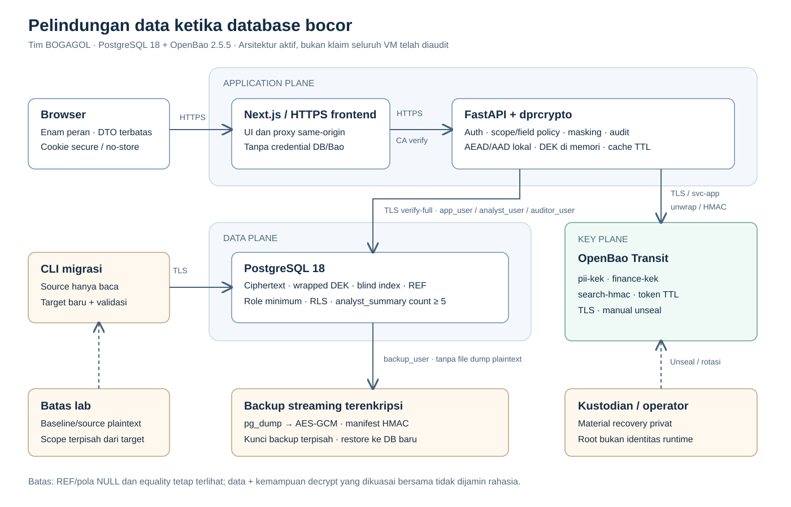

# Pelindungan Data Pribadi

Sistem ini membuat salinan database yang bocor lebih sulit dimanfaatkan, sementara
pengguna yang sah tetap dapat memakai aplikasi dan layanan dapat dipulihkan.

**Coba aplikasi:** [https://43.156.157.247/login](https://43.156.157.247/login) ·
**Login evaluator:** [accounts.md](accounts.md) ·
**Lihat hasil:** buka [docs/RESULTS.html](docs/RESULTS.html) di browser.

**Akses web saat ini:** login browser memerlukan penyelarasan Origin di VM
(HTTP403). Demo lokal dan halaman hasil dapat digunakan terpisah.

## Apa yang dikerjakan sistem?

1. **Assessment:** scanner memeriksa nama, isi, pola dan hubungan kolom untuk
   menghasilkan inventaris, klasifikasi serta risiko data pribadi.
2. **Hardening:** protection profile menentukan 25 field terenkripsi dari 29 kolom.
   Identitas dan keuangan memakai kunci data per record/domain; OpenBao menyimpan
   kunci pembungkus terpisah dari PostgreSQL. Tiga blind index mendukung pencarian exact.
3. **Layanan:** FastAPI dan Next.js memberikan data sesuai peran dan assignment record.
   Masking dilakukan sebelum respons dikirim ke browser. Analis hanya menerima agregat.
4. **Pembuktian:** migrasi dibandingkan dengan sumber, akses sah/terlarang diuji,
   salinan data dianalisis, dan backup terenkripsi di-restore serta diuji integritasnya.

Web adalah antarmuka pengguna dari solusi ini. Scanner, migrator, pengujian
kebocoran, benchmark dan pemulihan adalah komponen teknisnya, dijalankan melalui CLI.
Halaman web saja tidak membuktikan seluruh kontrol tersebut.



Diagram menunjukkan alur data dan pemisahan kunci; demo lokal memakai port acak.

## 1. Mencoba web yang sudah tersedia

**Status pemeriksaan terbaru:** halaman HTTPS tersedia, tetapi login browser dengan
Origin URL publik masih ditolak HTTP403. Akun cocok pada diagnostik non-browser;
indikasinya konfigurasi Origin runtime tidak sesuai. Sebelum akses evaluator,
operator perlu menyamakan `APP_ORIGIN` dengan URL akses lalu restart layanan terkait.
Lihat [langkah operator](docs/OPERATIONS.md#login-browser-ditolak-http403).
Jangan menonaktifkan CSRF/TLS; demo lokal tetap dapat dijalankan secara terpisah.

Buka URL aplikasi, lalu gunakan akun pada `accounts.md`. Akun itu untuk **deployment
tersebut**; akun lokal dibuat acak dan berbeda pada setiap demo. Tidak diperlukan
Docker atau instalasi Python untuk mencoba web.

| Peran | Yang dapat dicoba | Hasil yang diharapkan |
|---|---|---|
| `operator` | Buka daftar/detail record yang ditugaskan | Nama daftar dan identifier dimasking; FIN tidak dikirim |
| `privileged_officer` | Buka profil yang ditugaskan | PII sesuai izin terlihat; FIN tetap tidak dikirim |
| `finance_officer` | Buka record yang ditugaskan | FIN terlihat; identitas tertentu dimasking |
| `anggota` | Buka data sendiri dan coba ID lain | Data sendiri tersedia; record orang lain ditolak |
| `analyst` | Buka analytics | Agregat count≥5; daftar/detail anggota ditolak |
| `auditor` | Buka audit | Metadata aktivitas tersedia; data anggota ditolak |

Keluar sebelum berpindah akun, atau gunakan profil browser terpisah. Jumlah record
yang terlihat mengikuti assignment akun, bukan selalu 734. Jangan mengubah/menghapus
record pada deployment bersama saat demonstrasi; uji mutasi gunakan demo lokal.
[Rincian izin](docs/ACCESS_CONTROL.md).

## 2. Instalasi lokal

Prasyarat: **Python 3.11+**, **Node.js ≥20.9 dan npm**, **Docker Engine Linux +
Compose V2**, serta **Google Chrome**. Docker Desktop harus menampilkan engine siap.
Google Chrome diperlukan untuk uji browser otomatis, bukan hanya dependency Playwright.
Jalankan sebagai user biasa; jangan menggunakan root pada Linux.

Sediakan dataset panitia `02_data.sql` berisi 734 record melalui lokasi privat.
Dataset tidak disertakan dalam distribusi sumber publik. Input dibaca sebagai
literal INSERT; bukan SQL bebas yang langsung dieksekusi. Source/asli existing
pada server lain tidak digunakan oleh launcher.

Dari root proyek:

```powershell
python -m infra.reproduce setup
python -m infra.reproduce verify --data "C:/private/02_data.sql"
python -m infra.reproduce demo --data "C:/private/02_data.sql"
```

Linux: gunakan `python3` bila tidak ada alias `python`, dan path SQL Linux.
Jika input tersedia di `sql/baseline/02_data.sql` pada private clone, `--data` boleh
dihilangkan. `DPR_DEMO_DATA` juga dapat menunjuk path input. Tidak perlu membuat
atau memuat `.env` developer.

- **setup** memasang dependency Python dalam `.venv` dan `.venv-assessment`,
  menjalankan pip check, `npm ci` dan build frontend. Environment dipisahkan karena
  pin dependency layanan dan assessment berbeda.
- **verify** membuat stack baru pada port loopback acak; menjalankan import →
  assessment → profile → migrasi → enam akun → uji keamanan/browser → backup/restore.
  Service milik run dihentikan sesudah pemeriksaan.
- **demo** menjalankan pemeriksaan yang sama, lalu mempertahankan aplikasi HTTPS
  untuk dicoba. URL, path akun lokal dan CA ditampilkan; password/token tidak dicetak.
  Ctrl+C menghentikan service demo. Token demo berlaku satu jam.

Semua database/kunci baru milik run tersebut; launcher tidak menghubungi `pg-dpr`
atau mengubah deployment. OpenBao demo baru di-init/unseal oleh launcher hanya untuk
lingkungan sementara ini. Instalasi permanen menggunakan unseal manual dan custody
terpisah sebagaimana [panduan operasi](docs/OPERATIONS.md).

Sertifikat demo berasal dari CA lokal. Browser manual perlu mempercayai CA run
tersebut melalui mekanisme trust browser/OS. Tidak ada pemasangan CA otomatis. Uji Chrome otomatis mem-pin tepat sertifikat lokal yang
dibuat, tanpa menonaktifkan verifikasi TLS global. Jangan melewati kegagalan TLS.

Jika Docker tidak dapat dipakai, sediakan binary PostgreSQL **18** dan OpenBao
**2.5.5** resmi yang telah diverifikasi checksum, lalu jalankan:

```powershell
python -m infra.reproduce verify --data "C:/private/02_data.sql" --native-pg-bin "C:/tools/pgsql/bin" --native-bao-bin "C:/tools/bao.exe"
```

Argumen native yang sama berlaku untuk `demo`. Hasil yang sudah tersimpan mencakup
jalur native dengan service nyata. Docker di host pengujian terakhir mengalami
error engine; keberhasilan native tidak dianggap sebagai bukti Docker runtime.

## 3. Membaca hasil dan mendemonstrasikan solusi

Buka **[halaman hasil](docs/RESULTS.html)**. Halaman ini menjelaskan angka, skenario,
makna PASS/FAIL dan batasnya; dapat dibuka offline tanpa aplikasi berjalan.

```powershell
python -m infra.reproduce results
```

Command itu menyusun ulang halaman hasil dari catatan pengukuran, tanpa menjalankan
benchmark baru. Setiap `verify` juga menghasilkan halaman hasil run sendiri dan
ringkasan tahap di terminal. Lokasi: `evidence/reproduction/<run-id>/report.html`.
JSON/CSV di dekatnya adalah data pendukung yang dapat diperiksa mesin, bukan satu-satunya
cara membaca hasil. PASS berarti pemeriksaan yang dijalankan lulus; NOT_RUN/skip
berarti belum diuji, bukan PASS.

Alur demonstrasi yang disarankan, sekitar lima menit:

1. **Masalah dan rancangan:** tunjukkan diagram arsitektur serta keputusan 25 field
   AEAD/4 REF. Jelaskan kunci terpisah dari salinan database.
2. **Akses pengguna:** masuk operator lalu finance, bandingkan field; masuk anggota,
   coba record lain; masuk analyst, tunjukkan agregat dan penolakan daftar anggota.
3. **Bukti perlindungan:** buka hasil migrasi/crypto/browser dan tamper-backup.
   Pada lingkungan lokal, jalankan `verify` sebelum demonstrasi agar hasil run tersedia.
4. **Hasil dan konsekuensi:** tunjukkan simulasi kebocoran tanpa kunci dan dengan
   kemampuan domain, lalu grafik p95/throughput sebelum/sesudah. Sampaikan target
   kinerja yang belum tercapai dan risiko tersisa.

Jangan menampilkan password, token, private key atau isi data sensitif penuh pada
proyektor. Demonstrasi web, pengujian teknis, dan benchmark mempunyai tujuan berbeda.

## 4. Apa hasil yang telah dibuktikan?

- Migrasi dan validasi field 734/100k/1M mempunyai hasil tersimpan, sesuai scope
  masing-masing. Alur lokal 734 mencakup perbandingan seluruh record/field dan resume.
- Enam akun diuji menggunakan PostgreSQL/OpenBao nyata, TLS dan Chrome, termasuk
  layanan di atas hasil restore. Role/field/record, JSON, cookie dan storage diperiksa.
- Ciphertext yang diubah/ditukar ditolak; backup yang diubah ditolak; restore dua
  mode dan penghapusan anggota sintetis dari backup baru diuji.
- Pada skenario kebocoran tanpa kunci, field AEAD tidak berhasil dipulihkan. Metadata
  REF/NULL, equality blind index dan inferensi tetap merupakan kebocoran tersisa.
- Benchmark DB before/after pada 100k dan 1M tersedia beserta raw. **Target latensi
  dan throughput belum tercapai**; optimasi menurunkan overhead, error-rate tetap
  memenuhi target. Seri benchmark API belum lengkap.

Ini bukti kemampuan prototipe dalam scope pengujian, bukan sertifikasi keamanan
seluruh VM/host. [Model ancaman dan keterbatasan](docs/SECURITY.md).

## 5. Pengujian dan operasi teknis

```powershell
python -m infra.reproduce test
# Pemeriksaan integritas sumber dan dependency inventory:
.venv/Scripts/python -m infra.distribution check
```

Di Linux gunakan `.venv/bin/python`. Test menjalankan suite inti, aplikasi dan
assessment terpisah. Pengujian eksternal yang belum diaktifkan dilaporkan skip.
`verify` adalah pengujian nyata stack 734; unit test tidak menggantikannya.

[Operasi dan pemulihan](docs/OPERATIONS.md) mencakup instalasi permanen, startup,
unseal, migrasi, TLS, backup/restore dan rotasi. [Metodologi pengukuran](docs/METHODOLOGY.md)
menjelaskan dataset besar, B-P-P-B, arti metrik, raw results dan reproduksi benchmark.
Benchmark 100k/1M tidak dijalankan otomatis saat mencoba demo.

## Struktur sumber

```text
app/              Backend FastAPI dan frontend Next.js
infra/            TLS, OpenBao/PostgreSQL, launcher dan alat distribusi
scanner/, policy/ Inventarisasi dan profile perlindungan
migration/, sql/  Migrasi, skema dan role
scripts/backup/   Backup terenkripsi dan restore
toolkit/          Paket dprcrypto
datagen/          Pembangkit data sintetis
benchmark/        Pengukuran yang dapat diulang
verify/           Verifikasi kebocoran dan penyaji hasil
evidence/         Hasil uji dan hasil mentah
docs/             Arsitektur, spesifikasi, operasi, analisis dan dependency inventory
```

Kode [MIT](LICENSE), dokumentasi [CC BY-NC 4.0](LICENSE-DOCS.md);
[atribusi pihak ketiga](THIRD_PARTY_NOTICES.md). Dataset sintetis panitia tidak boleh
dipublikasikan. Akun evaluator pada `accounts.md` khusus akses demo; credential
PostgreSQL, OpenBao, root/unseal, SSH dan kunci backup tetap di penyimpanan privat.
