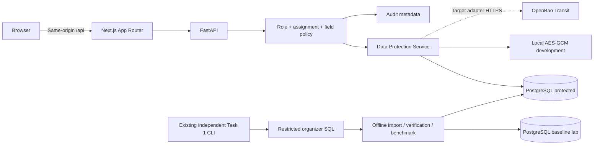

# Arsitektur aplikasi layanan

Browser memakai origin yang sama dengan Next.js. Rewrite `/api/*` meneruskan request ke FastAPI; session opaque tersimpan di HttpOnly cookie, bukan localStorage. FastAPI melakukan autentikasi, record scope SQL, field allowlist, lalu dekripsi minimum yang diperlukan. Hanya DTO yang diizinkan dikirim.

Panah diagram bukan bukti TLS. Lab lokal memakai HTTP dan koneksi PostgreSQL loopback tanpa TLS. Target HTTPS harus disiapkan terpisah. `api` Compose tidak menerima kredensial baseline atau migration owner.

Schema protected: `members(id, nama, ruangan, ktp_index, protected_fields, revision)`, `users`, `assignments`, `sessions`, `audit_events`, `import_runs`. `members.id` adalah synthetic source-row ordinal. FK hanya pada tabel baru milik aplikasi; tidak mengarang FK sumber. Alembic menyimpan schema eksplisit, `alembic check` memeriksa drift.

Allowlist demo publik: `nama`, `ruangan`, ID sintetis. Sebanyak 27 kolom lainnya disimpan sebagai JSON berisi envelope per field, atau NULL asli. Envelope lokal menyimpan provider, key version, nonce acak 96 bit, ciphertext+tag. AAD = `dpr:anggota:v1:<id>:<field>`. Metadata nonce/version bukan secret. Nama, ruangan, jumlah record, ukuran ciphertext dan pola kesamaan blind index tetap dapat diamati.

HMAC-SHA256 atas `dpr:no_ktp:v1\0` + nilai dengan whitespace luar dihapus. Kunci 256 bit terpisah dari kunci AES. Nilai sumber tidak dinormalisasi saat disimpan terenkripsi; nol depan, panjang 14 digit, NULL dan teks sintetis dipertahankan. Blind index tidak unik: pencarian mengembalikan semua kecocokan yang diizinkan, maksimum 50. Pencarian memakai POST, CSRF, rate limit, query terparameterisasi, record scope sebelum respons. Pencarian nama hanya pada allowlist plaintext `nama`.

Policy demo:

| Peran | Cakupan anggota | Kontak | Identitas/keuangan | Perubahan |
|---|---|---|---|---|
| Public viewer terautentikasi | Profil publik semua record | Tidak dikirim | Tidak dikirim | Tidak |
| Operator | Assigned saja | Masking server | Tidak dikirim | Contact jika `write:contact` |
| Staff | Assigned saja | Hanya jika `read:contact` | Per permission eksplisit | Contact/address per permission |
| Admin | Tidak ada implicit assignment | Tidak otomatis | Tidak otomatis | Pengelolaan user/audit per permission |

Staff demo tidak mendapat `read:finance`. Admin dapat memberikan permission eksplisit kepada akun staff melalui pengelolaan akses; pemisahan persetujuan dua orang belum diterapkan. Password dihash Argon2id (64 MiB, time cost 3, parallelism 2). Session hash dan CSRF hash disimpan di DB, expiration absolut 30 menit. Re-login mencabut sesi cookie lama. Perubahan akses mencabut semua sesi target; user nonaktif ditolak di setiap request.

Audit hanya actor ID, event, resource ID, waktu UTC, hasil, nama field, correlation UUID server. Kolom resource bersifat generic, bukan FK sumber. Role DB `app_user` boleh INSERT audit, tidak UPDATE/DELETE. Ini bukan audit tahan DBA atau bukti kriptografis append-only.

Scanner tetap di direktori Task1 dan tidak diimpor oleh runtime API. `scripts/verify_security.py` memakai parser scanner secara offline sebagai verifikasi independen saja. Privileged toolkit tidak memiliki route web. Baseline memiliki server, kredensial dan network sendiri, tidak memiliki UI atau switch plaintext.
