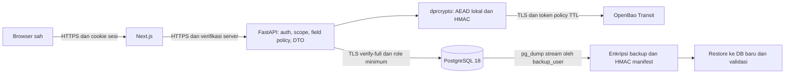

# 3. Rancangan, threat model dan kontrol kriptografi

## Arsitektur dan batas kepercayaan


Sumber vektor dan Mermaid tersedia pada assets/. Caption: rancangan logis aktif;
bukan inspeksi lengkap konfigurasi VM. Browser → Next.js/proxy → FastAPI →
PostgreSQL dan OpenBao. Migrasi/backup/verifikasi adalah tool operator terpisah.
OpenBao memegang KEK/search capability; DB membawa ciphertext/wrapped DEK/bidx.
Pemisahan pada satu laptop/VM bersifat logis dan kewenangan, bukan isolasi fisik OS.
Label cache pada gambar menunjukkan kemampuan toolkit; konfigurasi Service App
dan benchmark v2 pada snapshot ini **cache OFF**, bukan cache aktif secara default
untuk semua layanan.

Versi teks untuk penulis yang hanya menerima CONTEXT.md:



| Batas | Data yang melewati | Kontrol / residual |
|---|---|---|
| Browser–web/API | Input sah, cookie, DTO minimal | HTTPS, CSRF, HttpOnly/no-store/CSP; endpoint sah tetap menerima plaintext sesuai hak |
| API–DB | Query berparameter, ciphertext/REF metadata | Role per fungsi, TLS verify-full, RLS; principal dapat dipalsukan pemegang credential app_user |
| API–Bao | HMAC, wrap/unwrap DEK | CA/hostname, TTL/policy, fail closed; app sah memegang kemampuan dua domain |
| Operator–DB/key-plane | Migrasi/rewrap/restore | Identitas sementara/terpisah, evidence metadata; OS/root yang berkuasa melampaui batas |
| Arsip–restore | Backup terenkripsi + manifest | HMAC key terpisah, SHA256, autentikasi frame; produsen arsip/key tepercaya tetap asumsi |

## Threat model singkat

Aset: field identitas/keuangan, DEK/KEK/search key, credential DB/token/sesi,
integritas data, fungsi layanan, backup, evidence dan audit. Penyerang yang diuji
memiliki salinan dump tanpa key, capability domain PII/FIN/search terbatas, arsip
yang diubah, atau akun/record yang tidak berhak. Penyerang berkemampuan penuh pada
OS aplikasi/Bao/DB sekaligus bukan pihak yang secara kriptografis tetap dibatasi.

| Skenario | Pertahanan yang dituju | Bukti dan batas |
|---|---|---|
| Dump protected bocor | 25 field AEAD tidak pulih persis tanpa decrypt | Leakage nyata; REF/NULL/length/legacy mapping tetap terlihat |
| Wrapped DEK/ciphertext ditukar | AAD/AEAD menolak record/kolom salah | Test bit/swap/versi, bukan anti-delete/replay snapshot lama secara menyeluruh |
| FIN capability bocor | Tidak membuka PII AEAD | Probe ACL; FIN sendiri tetap mengungkap rekening/NPWP/nama rekening |
| Search capability bocor | Tidak mendekripsi AES | Kamus HMAC dapat mengembalikan tiga identifier, equality tetap terlihat |
| Pengguna aplikasi salah scope | Query scope/DTO/RLS memblokir | IDOR/field tests; credential app_user yang dicuri dapat mengubah principal |
| Analyst menggabungkan label kecil | Aggregate-only HAVING >=5 | A5 marginal; tidak DP atau perlindungan semua kombinasi/waktu |
| Backup diubah | Reject sebelum database baru dibuat/dipakai | Tamper report; HMAC key harus tetap privat |
| Key hilang/outage/revoked | Fail closed; recovery menurut custody | Unseal/restore lab ada; DR seluruh key-plane lintas mesin belum ada |

## Format field kontrak v1

AES-256-GCM dengan DEK 32 byte, nonce CSPRNG 12 byte, tag 16 byte:

```text
blob = 0x01 || nonce_12 || ciphertext || tag_16
AAD  = UTF8("dpr|v1|anggota_protected|" + column + "|" + uuid_lowercase + "|" + protection_version)
```

Tanggal menjadi ISO YYYY-MM-DD, angka string desimal, teks UTF-8. NULL tetap
NULL, tidak menjadi ciphertext string kosong; empty string berbeda dari NULL.
Tag/AAD/key/versi/UTF-8 salah menghasilkan DecryptionError/error generik tanpa
fallback plaintext/default. Blob field minimum 29 byte; overhead field non-NULL
29 byte sebelum overhead bytea/tuple/index/wrapper. Jangan menyamakan rumus field
dengan rasio ukuran DB yang benar-benar diukur.

Nonce yang berbeda pada test membuktikan perilaku sampel, bukan bebas collision
matematis selamanya. DEK per record/domain membatasi pemakaian kunci yang sama.
UUID protected bukan token yang membuat keseluruhan record anonim: legacy_row_id
tetap memetakan sumber dan atribut lain bisa diinferensikan.

## Envelope key dan OpenBao

Setiap record mendapat DEK_PII dan DEK_FIN baru dari CSPRNG lokal, lalu Transit
wrap dengan pii-kek/finance-kek. DB menyimpan vault:vN wrapper, tidak DEK plaintext.
DEK dipakai sementara di memori. Memiliki dump dan wrapper tanpa KEK/capability
decrypt tidak sama dengan memiliki kunci data.

OpenBao 2.5.5 server TLS, file backend volume persisten, bukan dev mode. Init
manual 3 unseal share/threshold 2; output root/share disimpan eksklusif di luar repo,
kemudian operator harus memisahkan custody. Penyimpanan bersama saat bootstrap
adalah kemudahan awal, bukan bukti multi-person custody sudah diterapkan.

| Policy | Capability | Larangan/batas |
|---|---|---|
| svc-app | Wrap/unwrap PII/FIN + HMAC | Bukan root; peran HTTP/field tidak diketahui Bao, harus ditegakkan backend |
| svc-migration | Wrap/datakey/HMAC | Tanpa decrypt; validator memakai identitas svc-app terpisah |
| svc-verify | Tanpa decrypt | Membuktikan skenario tidak berkunci, bukan token validator migrasi |
| key-operator | Rotate/rewrap/config | Tidak memiliki login DB; koordinator DB tetap operator berbeda |

Token per policy TTL terbatas, default bootstrap 3.600 s/maksimum14.400 s,
nonrenewable; runtime tidak auto-renew/auto-issue/root fallback. Operator harus
menyediakan token sah dan mengatur restart/unseal. Restart server persisten
memerlukan unseal manual; jangan mengulang init/mengganti key lama.

OpenBao 2.5.5 mendukung associated_data untuk operasi Transit yang sesuai; probe
menolak AAD salah/hilang. `context` pada rujukan berkaitan derivasi, bukan AAD
field. Desain utama tidak bergantung AAD Transit: pengikatan record/kolom ada
pada AES-GCM lokal. Remote wrap biasa tidak mengubah format AAD kontrak.

## Blind index

```text
message = UTF8("bidx|v1|" + column + "|" + normalize(value))
bidx    = HMAC-SHA256(search-hmac key version 1, message)  # 32 bytes
```

Key tidak diekspor: toolkit memakai Transit /hmac/search-hmac/sha2-256. Hasil
vault:vN base64 didekode menjadi32 byte. Label kolom memisahkan domain pesan,
bukan mengganti format dengan KDF lain. NULL tetap NULL. no_ktp hanya digit ASCII
tanpa menghapus nol awal; email strip+lower seluruhnya; pengguna strip dan
case-sensitive. Ini exact lookup, bukan substring/range/full-text search.

Versi HMAC dipin1 agar lookup stabil; rotate search key membutuhkan rebuild bidx
terkoordinasi. Rotasi pii-kek tidak otomatis mengubah bidx. Kebocoran equality/
frequency dan dictionary dengan oracle/key adalah tradeoff yang diukur.

## Client, batch dan cache setelah merge terbaru

Default transport toolkit sekarang `https_pool`, pool maksimal8, idle60s,
TLS>=1.2/CA/hostname, response cap4 MiB, tanpa redirect/retry. Env pemilih HTTPX
lama tersedia eksplisit. Transport lama sudah keep-alive; jangan menulis v2
“menghilangkan handshake pada setiap request” seolah sebelumnya selalu baru.
Batch HMAC lintas kolom/unwrap maksimal 100 item, urutan/count/error diperiksa;
satu kegagalan tidak boleh merilis sebagian hasil. Cache stats agregat, bukan
isi key. API digest lama masih ada, format crypto tetap v1.

Default **umum toolkit** cache15 s/256 entri (maks60 s/4096), tetapi **Service App
saat ini cache OFF** (`cache_ttl=0,max_entries=0`) dan benchmark v2 juga OFF.
Lease/cache tidak otomatis menjamin revokasi segera; cache hit dapat bertahan
sampai TTL dan cleanup lazy/best effort. Python/OS tidak menjamin zeroization.
Live acceptance lama tidak otomatis mengesahkan transport baru di semua VM.

## Tiga kondisi data

At rest: field protected dan artefak backup; bukan seluruh source plaintext,
WAL/file fisik/log/disk. In transit: browser HTTPS, DB verify-full dan Bao CA/hostname.
In use: backend scope/DTO, decrypt minimum, cache OFF pada app, audit minim nilai.
TLS baseline bench/scanner boleh plaintext dari satu alamat terkonfigurasi untuk
kondisi awal; protected/restore dan role lain tidak memperoleh pengecualian itu.
Mode plain aplikasi tetap memakai DB TLS verify-full: baseline benchmark DB tanpa
TLS tidak boleh dipakai seolah baseline API dengan transport yang sama.
