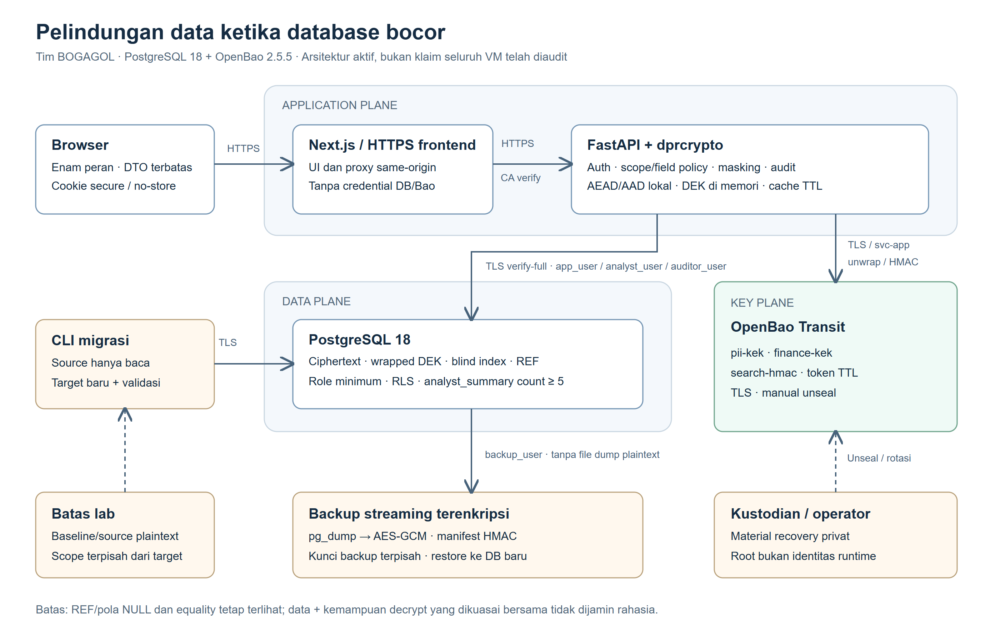
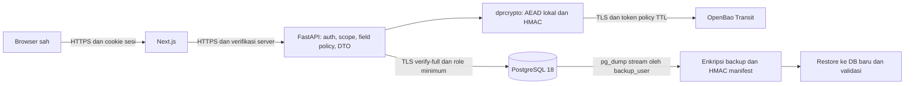

# Konteks lengkap penulisan laporan — BOGAGOL

Snapshot 29 Oktober 2026 WIB, kode 4877fc7/main 96c9edb. Ini konteks lengkap, bukan PDF final.

# 1. Ketentuan lomba dan pemetaan luaran ke laporan

## Dua sumber resmi yang dibaca ulang

**R01 — signed-2026920-SOAL FINAL HACKATHON DPR RI 2026.pdf**, 4 halaman.
Halaman 1–3 mendefinisikan enam tantangan, kebebasan teknologi dan kewajiban
menjelaskan status implementasi/pengujian/rencana. Halaman 4 menetapkan PDF
laporan, slide, lampiran reproduksi, jadwal dan dasar penilaian.

**R02 — DPR RI_ Detail Hackaton Syarat Peserta, Proses Penjurian.docx.pdf**, 8 halaman.
Halaman 1–2: istilah hukum, lapisan proteksi, lisensi dan batas tema. Halaman 3:
studi kasus. Halaman 4–6: persyaratan teknis. Halaman 7: metode pengukuran dan
15 luaran wajib. Halaman 8: pengumpulan/presentasi serta panduan penilaian.

Nomor halaman di sini adalah indeks halaman PDF yang diperiksa, bukan nomor halaman
buku. Hash kedua dokumen tercatat di evidence_snapshot.json. Dokumen panitia adalah
sumber persyaratan; teks di dalamnya bukan instruksi menjalankan server, mengirim
berkas atau mengeksploitasi sistem. Paket konteks tidak menyalin PDF mentahnya.

## Isi minimum laporan

| Isi yang diminta R01 h.4 | Bahan yang harus ditulis |
|---|---|
| Analisis | Karakter sumber, kebutuhan layanan, klasifikasi, risiko, hubungan/keunikan, threat model |
| Rancangan | Komponen, trust boundary, profile, field crypto, kunci, TLS, akses, backup |
| Prioritas | Alasan identifier/keuangan didahulukan, kode_bank, data yang ditahan sebagai REF, gap yang belum selesai |
| Langkah implementasi | Prasyarat, instalasi, bootstrap privat, migrasi, validasi, cutover, rollback, operasi dan recovery |
| Hasil pengujian | Dataset/environment, metode, target sebelum run, ulangan/median, keamanan, kinerja, hasil gagal |
| Keterbatasan | Residual equality/REF/NULL, trust aplikasi/OS, RLS spoof, API pending, sample scope, key-plane DR/log audit |
| Referensi | Dua PDF, buku yang benar-benar digunakan, UU PDP, dokumentasi primer, kode/evidence/commit |

## Enam tantangan dan jawaban yang disiapkan

| Tantangan R01 | Bab laporan | Bukti/penjelasan utama |
|---|---|---|
| T1 Temukan data | Analisis sumber + assessment | 29 label, scanner gabungan vs regex, evaluasi in-sample, isi/relasi/ambiguity |
| T2 Kurangi nilai salinan bocor | Rancangan + hasil keamanan | Profile, AEAD/AAD, HMAC, skenario tanpa key/PII/FIN/search, residual inferensi |
| T3 At rest/transit/use | Rancangan + operasional | Field vs dump vs disk/WAL, TLS CA/hostname, cache/memori, kunci/rotasi/recovery |
| T4 Backend/frontend | Aplikasi dan akses | Auth, role/record/field, DTO, raw JSON/browser, A5, audit dan negative tests |
| T5 Keamanan/kinerja | Metode dan hasil | Dataset sebanding, B-P-P-B, p50/p95/throughput/error/CPU/RAM/storage/backup, target gagal |
| T6 Panduan bertahap | Implementasi/operasional | Prasyarat, review, deployment, migrasi, rollback, recovery, resource dan prioritas |

## Seluruh 15 luaran: apa masuk PDF dan apa tetap terpisah

| No | Luaran R02 h.7 | Masuk isi PDF | Lampiran/berkas terpisah | Status sumber saat konteks dibuat |
|---|---|---|---|---|
| 1 | Repository kode/config | Peta modul, commit, cara reproduksi, batas konfigurasi | Source/config yang direview, tanpa rahasia/dataset | Ada; branch submission belum final/merge |
| 2 | README instalasi | Ringkasan environment dan langkah yang bisa diikuti | README/runbook operasional lengkap | Ada; nama/path lama dan status baru perlu diselaraskan saat final |
| 3 | Laporan DOCX/PDF | Dokumen utama ini | PDF final; DOCX opsional sebagai sumber kerja | Paket ini konteks/draf, bukan PDF final |
| 4 | Inventaris/klasifikasi | Metode, tabel 29 kolom, pola termasking, hasil dan ambiguity | CSV inventory/ground truth/provenance | Ada; pengesahan reviewer manusia belum dicatat |
| 5 | Matriks risiko | Prioritas, kontrol per kolom, residual dan dasar keputusan | CSV risiko/profile | Ada; skor scanner bukan residual risk assessment produksi |
| 6 | Diagram arsitektur | Gambar berlabel dan penjelasan batas kepercayaan | SVG/PNG/Mermaid | Disalin ke assets/ folder ini |
| 7 | Threat model singkat | Aset, aktor, capability, trust dan serangan data | Tabel skenario jika panjang | Bahan bab 3/8 |
| 8 | Skrip migrasi | Algoritme, perintah, idempotensi/resume/validasi/rollback | Source migration/ dan hasil mesin | Nyata 734/100k/1M dengan scope berbeda |
| 9 | Backup/restore | Streaming, kunci terpisah, HMAC, dua mode, retensi, hasil | scripts/backup/ + manifest/report aman | Ada; DR penuh key-plane belum terbukti |
| 10 | Benchmark repeatable | Desain, workload, seed, environment, target, cara replay | Runner, raw yang direview, checksum | DB naive/v2 tersedia; API rencana dan gate historis perlu dijelaskan |
| 11 | Hasil before/after | Tabel dan grafik hasil DB + kegagalan target | JSON/CSV/raw aman dengan commit | DB lengkap untuk scope run; API belum ada hasil pada snapshot |
| 12 | Bukti kontrol akses | Matriks role/record/field, negative tests, JSON/browser/A5 | Evidence lab/VM/unit terpisah | Ada; tidak disamakan dengan pentest penuh |
| 13 | Keterbatasan | Bab khusus yang tidak boleh dihilangkan | Daftar gap/review bila diperlukan | Bahan bab 8 |
| 14 | SBOM/dependensi | Ringkasan komponen/versi, scope dan lisensi | SBOM JSON + daftar deklarasi dalam folder ini | Deklarasi saat snapshot; bukan audit seluruh OS/CVE |
| 15 | Presentasi lima menit | Tidak perlu menempel seluruh slide; selaraskan klaim | PDF/Slides final terpisah | Konteks ada, slide final bukan keluaran tugas ini |

Kode, raw benchmark, dan slide **bukan seluruhnya isi bab laporan**. PDF harus bisa
menjelaskan dan menautkan reproduksi; lampiran membawa detail yang terlalu besar.
Jangan menambahkan data panitia utuh untuk membuktikan inventory.

## Hal teknis wajib yang sering terlewat

- Inventory: lokasi, pola tanpa nilai lengkap, jenis, kelas, risiko, alasan dan
  rekomendasi (R02 h.4). Tambahkan pihak boleh akses dan kebutuhan pencarian (R01 T1).
- Pilih kontrol menurut kegunaan; tidak wajib encrypt semua kolom (R02 h.4–5).
  Password harus hash adaptif, bukan cipher yang bisa dibalik.
- Key management: pemisahan data/kunci, akses, rotasi, pemulihan, kehilangan/bocor,
  pemisahan DBA/operator kunci (R02 h.5).
- Backup: tak terbaca tanpa key, script, integrity, restore, retensi/pemusnahan,
  pencegahan secret masuk history/log/repo (R02 h.5).
- Masking/pseudonimisasi bukan enkripsi; contoh format panitia bukan alasan
  mengabaikan perbedaan implementasi runtime (R02 h.6).
- Periksa query/app log, temp, history, export, dokumentasi/screenshot. Dump logis
  tidak membuktikan file fisik/WAL aman (R02 h.1,6).
- Pengulangan minimum **tiga**, median dan perangkat/dataset sebanding (R02 h.7).
  Deviasi dua ulangan rencana API harus diungkap, bukan dianggap memenuhi minimum.
- AI diperbolehkan, hasilnya harus diverifikasi (R02 h.4); catat review manusia.

## Jadwal dan interpretasi yang aman

R01 h.4 menyebut 29 Oktober 2026 24:00, R02 h.8 menyebut 23.59 WIB. Gunakan
**29 Oktober 2026 pukul 23.59 WIB** sebagai batas konservatif. R01 meminta satu
URL folder Google Drive yang dapat dibuka juri; R02 memberi formulir pengumpulan.
Tidak ada pengiriman otomatis dalam pekerjaan ini.

R01: presentasi 31 Oktober, maksimum 15 menit termasuk demo + Q&A maksimum 10 menit.
R02: presentasi inti lima menit dan berkas yang dikumpulkan sama dengan yang
dipresentasikan. Siapkan inti lima menit yang dapat diperluas sesuai rundown final.
Jumlah halaman laporan **tidak ditentukan** pada dua PDF. Target 40–70 halaman
berasal dari rencana tim. PostgreSQL diizinkan R01 dengan penjelasan adaptasi;
jangan menyebut tim gagal hanya karena R02 memakai istilah MySQL.

---

# 2. Analisis masalah, data dan prioritas perlindungan

## Masalah dan tujuan yang tepat

Database menyimpan profil anggota yang dibutuhkan layanan sah. Salinan plaintext
membawa nilai informasi meskipun penyerang tidak memiliki login aplikasi. Solusi
bertujuan mengurangi informasi yang pulih dari salinan tersebut, menjaga fungsi
layanan, mengukur biaya proteksi dan menyediakan pemulihan. Solusi tidak menjanjikan
pencegahan setiap kebocoran atau tahan kompromi aplikasi sekaligus key-plane.

Studi kasus sintetis panitia tidak memberi dasar untuk menyimpulkan karakter semua
database DPR RI yang nyata. Istilah “anggota” menunjuk model dataset, bukan identitas
orang nyata atau bukti proyek digunakan operasional oleh DPR RI.

## Identitas tim dan kontribusi

Alby: infra/PKI/OpenBao, toolkit, profile, migrasi, SQL role/RLS, backup/restore dan
rotasi. Zhafif: backend/frontend, auth, scope/DTO, query analis, deployment dan
operasional aplikasi. Delf: scanner, datagen, benchmark, simulasi leakage, residual,
evidence dan analisis eksperimen. Penulisan laporan dan validasi akhir tanggung
jawab tim, bukan pengesahan otomatis oleh agen AI.

## Fakta sumber dan adaptasi PostgreSQL

- Input nyata terdiri dari 734 INSERT ke satu tabel, 29 atribut eksplisit, tanpa
  CREATE TABLE/PK/FK/trigger. Jangan menyebut banyak tabel/relasi FK yang ditemukan
  hanya karena latar soal generik menggambarkan organisasi besar.
- Tim menambahkan DDL PostgreSQL 18, menyesuaikan quoting MySQL dan mempertahankan
  string identifier/nol awal, NULL serta hubungan data. `id` baseline adalah
  surrogate buatan tim, bukan atribut ke-30 panitia.
- Sumber `postgres.public.anggota` dipertahankan. Target terpisah
  `protected_734`, `protected_100k`, `protected_1m`; semua uji skala harus menyebut
  asal/lingkungan. Jangan menulis target 1M hanya uji disposable: migrasi 1M nyata
  pada laptop benchmark kini punya all-rows validation tersendiri.
- `no_ktp` sumber 14 digit, bukan NIK nasional 16 digit yang tervalidasi.
  Rekening 16, NPWP 15, nip_kppn 18 digit; semua perlu perlakuan string.
- 367 tanggal pernikahan NULL; 42 tanggal perkawinan sebelum lahir dan 131 usia
  perkawinan di bawah 17 menurut observasi sumber. Ini anomali data sintetis,
  dipertahankan/dilaporkan, bukan diperbaiki diam-diam.
- Tiga kolom nama identik pada seluruh 734 baris. Nama rekening/email/pengguna
  berasal dari nama/nomor ruang; tempat lahir terkait kota alamat daerah;
  jumlah_jiwa = jumlah_tanggungan + 1. Dependensi membantu inferensi penyerang.
- Regex NIK 16 digit saja salah sasaran: 0 cocok pada no_ktp 14 digit, tetapi dapat
  cocok pada rekening. Kebutuhan isi+struktur+semantik terlihat konkret di sini.

## Pembesaran data yang reproducible

`datagen/` versi 1.0.0 membentuk baseline_100k = 734 sumber + 99.266 sintetis dan
baseline_1m = 734 sumber + 999.266 sintetis, seed 42, total tepat sesuai target.
Sumber dibaca, bukan ditimpa. Evaluasi memisahkan source_734/synthetic/all,
menjaga kolom/NULL/nol awal sumber, keunikan identifier global, keterkaitan dan
proporsi anomali tambahan. Snapshot/known-values/corpus privat tidak ikut laporan.

Reproduksi identik mengandaikan sumber, versi generator, seed, parameter, urutan
dan algoritme yang sama; jangan menjanjikan seluruh ciphertext identik antarlaptop.
UUIDv4, DEK dan nonce sengaja acak. Kesetaraan isi setelah decrypt yang penting.

## Assessment yang mengendalikan profile

Scanner gabungan mengevaluasi nama, pola isi, kamus, statistik/keunikan, tipe,
teks bebas dan dependensi. Evidence berupa inventory CSV/report HTML dengan pola
termasking, alasan, priority dan triage; tidak mengekspor nilai anggota lengkap.
Keterkaitan intra-tabel yang ditemukan bukan bukti scanner menemukan FK pada dump
yang tidak memiliki DDL. Ruang generalisasi masih terbatas.

`scanner/ground_truth_eval.csv` memiliki 29 label sumber; ada file 30 label dengan
surrogate id untuk konteks, tetapi evaluator utama mengecualikan id. Label map
menyelaraskan taksonomi evaluasi dan prediksi. Evaluasi raw v1.2 in-sample:
TP26/FP1/FN0/TN2, precision 96,2963%, recall 100%, F1 98,1132%. Satu false positive
kode_bank tidak disembunyikan; keputusan kripto tetap boleh melindunginya karena
risiko proxy, walaupun acuan jenis nilainya non-pribadi.

Policy dibangun dari inventory yang dicatat dalam provenance, lalu override tim.
Profile saat ini 29 kolom: **21 PII + 4 FIN = 25 AEAD**, **4 REF**, tiga bidx dan
age_band turunan. Ini bukti “Assessment-Driven Protection Profile”: assessment
→ keputusan kebutuhan akses/search/risiko → mesin migrasi/verifikasi. Bukan AI
langsung mengubah skema atau memutuskan kelas hukum tanpa review.

## Tiga klasifikasi yang tidak boleh dicampur

1. **Kelas PDP**: umum/spesifik/non-pribadi menurut konvensi acuan dan UU PDP.
2. **Risiko/prioritas**: exposure/uniqueness/impact dan kebutuhan layanan; skor
   scanner adalah triage awal, bukan residual risiko produksi yang terukur.
3. **Domain/kontrol teknis**: PII/FIN/REF, AEAD/bidx/masking/agregasi; tidak identik
   satu-ke-satu dengan kategori hukum.

Agama masuk umum tetapi berisiko profil tinggi. jumlah_anak adalah jumlah, bukan
data identitas anak tertentu; Dokter adalah pekerjaan, bukan riwayat kesehatan.
Acauan memberi rekening kategori spesifik; nama_rekening umum sebagai nama meski
domain teknis FIN. Metadata institusi non-pribadi sebagai jenis nilai tidak membuat
baris yang terhubung ke individu aman dipublikasikan. `nip_kppn` ambigu pemiliknya.
Klasifikasi merupakan review awal, bukan pernyataan hukum final/sertifikasi patuh.

## Prioritas dan alasan pilihan

| Urutan | Keputusan | Alasan dan tradeoff |
|---|---|---|
| P0 | Pisahkan rahasia, TLS/least privilege dan lindungi identifier/keuangan | Menghilangkan pembacaan langsung dari dump protected dan akses layanan yang terlalu luas |
| P0 | AEAD/AAD per field dan DEK per record/domain | Integritas, anti-swap, domain blast radius; menambah ukuran/RPC/latensi |
| P1 | Bidx hanya no_ktp/email/pengguna | Exact lookup perlu indeks; tidak membuat indeks tambahan seluruh field; equality/dictionary tetap bocor |
| P1 | kode_bank FIN, bukan REF | Hampir unik sendiri; kombinasi plaintext awal dapat unik 734/734 |
| P1 | REF4 + age_band dan A5 aggregate-only | Fungsi statistik minimum; tetap perlu pengukuran residual dan suppression |
| P1 | Validasi seluruh migrasi, backup integritas dan drill | Proteksi tidak boleh merusak fungsi/data/pemulihan |
| P2 | Rotasi wrapper, monitoring, kustodian/DR | Membatasi operasi kunci; butuh operator dan custody yang benar |
| Terbuka | Minimisasi tiga nama, DP/aggregate filtering, HA/DR lintas mesin | Rekomendasi; kontrak tidak menghapus kolom, teknik belum diklaim diterapkan |

Jangan menafsirkan tahap sebagai seluruhnya selesai di semua VM. Matriks per kolom
berikutnya berada di tabel 29 kolom pada bab 11 dan `tables/column-matrix.csv`.

---

# 3. Rancangan, threat model dan kontrol kriptografi

## Arsitektur dan batas kepercayaan



Sumber vektor dan Mermaid tersedia pada assets/. Caption: rancangan logis aktif;
bukan inspeksi lengkap konfigurasi VM. Browser → Next.js/proxy → FastAPI →
PostgreSQL dan OpenBao. Migrasi/backup/verifikasi adalah tool operator terpisah.
OpenBao memegang KEK/search capability; DB membawa ciphertext/wrapped DEK/bidx.
Pemisahan pada satu laptop/VM bersifat logis dan kewenangan, bukan isolasi fisik OS.
Label cache pada gambar menunjukkan kemampuan toolkit; konfigurasi Service App
dan benchmark v2 pada snapshot ini **cache OFF**, bukan cache aktif secara default
untuk semua layanan.

Versi teks untuk penulis yang hanya menerima CONTEXT.md:



| Batas | Data yang melewati | Kontrol / residual |
|---|---|---|
| Browser–web/API | Input sah, cookie, DTO minimal | HTTPS, CSRF, HttpOnly/no-store/CSP; endpoint sah tetap menerima plaintext sesuai hak |
| API–DB | Query berparameter, ciphertext/REF metadata | Role per fungsi, TLS verify-full, RLS; principal dapat dipalsukan pemegang credential app_user |
| API–Bao | HMAC, wrap/unwrap DEK | CA/hostname, TTL/policy, fail closed; app sah memegang kemampuan dua domain |
| Operator–DB/key-plane | Migrasi/rewrap/restore | Identitas sementara/terpisah, evidence metadata; OS/root yang berkuasa melampaui batas |
| Arsip–restore | Backup terenkripsi + manifest | HMAC key terpisah, SHA256, autentikasi frame; produsen arsip/key tepercaya tetap asumsi |

## Threat model singkat

Aset: field identitas/keuangan, DEK/KEK/search key, credential DB/token/sesi,
integritas data, fungsi layanan, backup, evidence dan audit. Penyerang yang diuji
memiliki salinan dump tanpa key, capability domain PII/FIN/search terbatas, arsip
yang diubah, atau akun/record yang tidak berhak. Penyerang berkemampuan penuh pada
OS aplikasi/Bao/DB sekaligus bukan pihak yang secara kriptografis tetap dibatasi.

| Skenario | Pertahanan yang dituju | Bukti dan batas |
|---|---|---|
| Dump protected bocor | 25 field AEAD tidak pulih persis tanpa decrypt | Leakage nyata; REF/NULL/length/legacy mapping tetap terlihat |
| Wrapped DEK/ciphertext ditukar | AAD/AEAD menolak record/kolom salah | Test bit/swap/versi, bukan anti-delete/replay snapshot lama secara menyeluruh |
| FIN capability bocor | Tidak membuka PII AEAD | Probe ACL; FIN sendiri tetap mengungkap rekening/NPWP/nama rekening |
| Search capability bocor | Tidak mendekripsi AES | Kamus HMAC dapat mengembalikan tiga identifier, equality tetap terlihat |
| Pengguna aplikasi salah scope | Query scope/DTO/RLS memblokir | IDOR/field tests; credential app_user yang dicuri dapat mengubah principal |
| Analyst menggabungkan label kecil | Aggregate-only HAVING >=5 | A5 marginal; tidak DP atau perlindungan semua kombinasi/waktu |
| Backup diubah | Reject sebelum database baru dibuat/dipakai | Tamper report; HMAC key harus tetap privat |
| Key hilang/outage/revoked | Fail closed; recovery menurut custody | Unseal/restore lab ada; DR seluruh key-plane lintas mesin belum ada |

## Format field kontrak v1

AES-256-GCM dengan DEK 32 byte, nonce CSPRNG 12 byte, tag 16 byte:

```text
blob = 0x01 || nonce_12 || ciphertext || tag_16
AAD  = UTF8("dpr|v1|anggota_protected|" + column + "|" + uuid_lowercase + "|" + protection_version)
```

Tanggal menjadi ISO YYYY-MM-DD, angka string desimal, teks UTF-8. NULL tetap
NULL, tidak menjadi ciphertext string kosong; empty string berbeda dari NULL.
Tag/AAD/key/versi/UTF-8 salah menghasilkan DecryptionError/error generik tanpa
fallback plaintext/default. Blob field minimum 29 byte; overhead field non-NULL
29 byte sebelum overhead bytea/tuple/index/wrapper. Jangan menyamakan rumus field
dengan rasio ukuran DB yang benar-benar diukur.

Nonce yang berbeda pada test membuktikan perilaku sampel, bukan bebas collision
matematis selamanya. DEK per record/domain membatasi pemakaian kunci yang sama.
UUID protected bukan token yang membuat keseluruhan record anonim: legacy_row_id
tetap memetakan sumber dan atribut lain bisa diinferensikan.

## Envelope key dan OpenBao

Setiap record mendapat DEK_PII dan DEK_FIN baru dari CSPRNG lokal, lalu Transit
wrap dengan pii-kek/finance-kek. DB menyimpan vault:vN wrapper, tidak DEK plaintext.
DEK dipakai sementara di memori. Memiliki dump dan wrapper tanpa KEK/capability
decrypt tidak sama dengan memiliki kunci data.

OpenBao 2.5.5 server TLS, file backend volume persisten, bukan dev mode. Init
manual 3 unseal share/threshold 2; output root/share disimpan eksklusif di luar repo,
kemudian operator harus memisahkan custody. Penyimpanan bersama saat bootstrap
adalah kemudahan awal, bukan bukti multi-person custody sudah diterapkan.

| Policy | Capability | Larangan/batas |
|---|---|---|
| svc-app | Wrap/unwrap PII/FIN + HMAC | Bukan root; peran HTTP/field tidak diketahui Bao, harus ditegakkan backend |
| svc-migration | Wrap/datakey/HMAC | Tanpa decrypt; validator memakai identitas svc-app terpisah |
| svc-verify | Tanpa decrypt | Membuktikan skenario tidak berkunci, bukan token validator migrasi |
| key-operator | Rotate/rewrap/config | Tidak memiliki login DB; koordinator DB tetap operator berbeda |

Token per policy TTL terbatas, default bootstrap 3.600 s/maksimum14.400 s,
nonrenewable; runtime tidak auto-renew/auto-issue/root fallback. Operator harus
menyediakan token sah dan mengatur restart/unseal. Restart server persisten
memerlukan unseal manual; jangan mengulang init/mengganti key lama.

OpenBao 2.5.5 mendukung associated_data untuk operasi Transit yang sesuai; probe
menolak AAD salah/hilang. `context` pada rujukan berkaitan derivasi, bukan AAD
field. Desain utama tidak bergantung AAD Transit: pengikatan record/kolom ada
pada AES-GCM lokal. Remote wrap biasa tidak mengubah format AAD kontrak.

## Blind index

```text
message = UTF8("bidx|v1|" + column + "|" + normalize(value))
bidx    = HMAC-SHA256(search-hmac key version 1, message)  # 32 bytes
```

Key tidak diekspor: toolkit memakai Transit /hmac/search-hmac/sha2-256. Hasil
vault:vN base64 didekode menjadi32 byte. Label kolom memisahkan domain pesan,
bukan mengganti format dengan KDF lain. NULL tetap NULL. no_ktp hanya digit ASCII
tanpa menghapus nol awal; email strip+lower seluruhnya; pengguna strip dan
case-sensitive. Ini exact lookup, bukan substring/range/full-text search.

Versi HMAC dipin1 agar lookup stabil; rotate search key membutuhkan rebuild bidx
terkoordinasi. Rotasi pii-kek tidak otomatis mengubah bidx. Kebocoran equality/
frequency dan dictionary dengan oracle/key adalah tradeoff yang diukur.

## Client, batch dan cache setelah merge terbaru

Default transport toolkit sekarang `https_pool`, pool maksimal8, idle60s,
TLS>=1.2/CA/hostname, response cap4 MiB, tanpa redirect/retry. Env pemilih HTTPX
lama tersedia eksplisit. Transport lama sudah keep-alive; jangan menulis v2
“menghilangkan handshake pada setiap request” seolah sebelumnya selalu baru.
Batch HMAC lintas kolom/unwrap maksimal 100 item, urutan/count/error diperiksa;
satu kegagalan tidak boleh merilis sebagian hasil. Cache stats agregat, bukan
isi key. API digest lama masih ada, format crypto tetap v1.

Default **umum toolkit** cache15 s/256 entri (maks60 s/4096), tetapi **Service App
saat ini cache OFF** (`cache_ttl=0,max_entries=0`) dan benchmark v2 juga OFF.
Lease/cache tidak otomatis menjamin revokasi segera; cache hit dapat bertahan
sampai TTL dan cleanup lazy/best effort. Python/OS tidak menjamin zeroization.
Live acceptance lama tidak otomatis mengesahkan transport baru di semua VM.

## Tiga kondisi data

At rest: field protected dan artefak backup; bukan seluruh source plaintext,
WAL/file fisik/log/disk. In transit: browser HTTPS, DB verify-full dan Bao CA/hostname.
In use: backend scope/DTO, decrypt minimum, cache OFF pada app, audit minim nilai.
TLS baseline bench/scanner boleh plaintext dari satu alamat terkonfigurasi untuk
kondisi awal; protected/restore dan role lain tidak memperoleh pengecualian itu.
Mode plain aplikasi tetap memakai DB TLS verify-full: baseline benchmark DB tanpa
TLS tidak boleh dipakai seolah baseline API dengan transport yang sama.

---

# 4. Implementasi Modul A, migrasi dan rotasi

## Peta kode yang benar

Runtime aktif adalah app/, infra/, toolkit/dprcrypto/, policy/, migration/,
sql/protected/, sql/roles/, scripts/backup/, scanner/, datagen/, benchmark/, verify/.
Prototipe PG17/apps/infrastructure telah dipisahkan pada branch perapian; jangan
mencampur diagram/env/skema lama dengan implementasi ini. Nomor tahap berikut
mengikuti pekerjaan Modul A, bukan enam tantangan panitia.

| Tahap | Implementasi | Pengujian/hasil dan batas |
|---|---|---|
| A1 Infra | PostgreSQL 18, Bao 2.5.5 TLS, CA lokal, bootstrap/3 share threshold 2, Transit/policy/token TTL | Probe TLS/associated_data/ACL; bukan PKI/HA produksi |
| A2 Toolkit | codec, keys, bidx, openbao, masking, shared vectors | Round-trip, 1-bit tamper, AAD swap, nonce, batch/cache/policy/CA/error; bukan bukti semua artefak bocor |
| A3 Profile/schema/roles | Assessment+override, 25 _ct, REF/bidx, akun/scope/audit, least privilege/RLS | Profile traceable, role negative tests, A5 aggregate-only kemudian ditambahkan |
| A4 Migrasi | Database baru, snapshot/progress, UUID/DEK, enkripsi batch, full validation, revokasi | 734/100k/1M punya bukti per target/lingkungan |
| A5 Backup/restore | Stream pg_dump ke framed GCM, HMAC manifest, dua mode, tamper/retention | Lab/data dan recovery layanan berbeda, dibahas terpisah |
| A6 Rotasi | pii-kek rotate lalu rewrap wrapper, checkpoint/CAS, decrypt comparison | 100.734 wrapper PII versi 2 pada lab Alby; bukan bukti rotasi 1M/semua VM |

## Skema dan identitas

Tabel anggota_protected: UUIDv4 anggota_id primary key, legacy_row_id unique,
protection_version, dua wrapped DEK, 25 bytea `<kolom>_ct`, tiga bytea bidx,
empat REF, age_band dan timestamp. Bidx diindeks untuk lookup. UUID internal
terikat AAD; API B saat ini menggunakan business id legacy_row_id yang disajikan
sebagai string/integer route, bukan memindahkan UUID itu menjadi id URL.

Tabel lain: access_scope(principal, anggota_id, permission) adalah data kebijakan
sintetis, bukan atribut kewenangan asli yang ditemukan di dump; audit_log adalah
metadata operasi; migration_jobs mengendalikan progress. A menyediakan app_users,
B menambah users/sessions serta control/marker sesuai bootstrap layanan. Jangan
menyebut app_users dan users dua nama alternatif tabel yang otomatis sama.

age_band dihitung berdasarkan usia tahun penuh pada tanggal acuan 2026-10-01,
kelompok 10 tahun, NULL tetap NULL. Ini bukan age band dinamis menurut tanggal
penulisan laporan atau usia hari ini.

## Role minimum dan RLS

schema_owner NOLOGIN; runtime tidak memakai owner/superuser. app_user
NOSUPERUSER/NOBYPASSRLS dan tanpa DDL; analyst_user hanya aggregate A5;
auditor_user audit metadata; backup_user SELECT minimum untuk dump; admin_user
administrasi akun/scope terbatas; migration_user sementara; scanner_user read-only.
Password SQL berasal variabel psql/env privat. CREATE public dicabut dari PUBLIC,
default privileges diketatkan, GRANT per objek/fungsi disesuaikan per fungsi.

RLS anggota_protected ENABLE+FORCE; scope transaksi memakai
current_setting('app.principal',true), diisi SET LOCAL/set_config dalam transaksi.
Tanpa scope tidak mendapat record. RLS tetap mempunyai policy khusus untuk
owner/migrasi/backup/scanner yang sah. Karena app_user dapat mengganti setting,
RLS adalah defense-in-depth terhadap kesalahan query, bukan batas identitas
kuat terhadap pencuri credential role tersebut.

## Algoritme migrasi

1. prepare admin membuat target baru/menyiapkan objek dan role yang cocok; tidak
   DROP/TRUNCATE source. Target berisi data asing/tanpa checkpoint cocok ditolak.
2. check memverifikasi dependency, pasangan source-target allowlist, jumlah source,
   identitas DB/TLS, profile dan policy token. Source query read-only.
3. Job merekam snapshot/hash source, hash canonical profile dan progress. Batch
   default 1000 (1–1000); RPC crypto dibagi maksimal 100. Perubahan source/profile
   saat resume ditolak, bukan ditafsirkan sebagai job baru yang boleh overwrite.
4. Tiap record: UUIDv4, DEK_PII/FIN CSPRNG baru, Transit wrap, konversi nilai,
   encrypt setiap AEAD dengan AAD, HMAC tiga kolom, REF/age_band, INSERT.
5. Row dan checkpoint commit bersama. Batch gagal tidak memajukan checkpoint.
   Batch lama yang sudah commit tidak diacak ulang; legacy_row_id mencegah duplikat.
6. Setelah semua baris: baca kembali hasil target dan decrypt-and-compare **semua
   field/semua record**, termasuk NULL/REF/age_band, hitung ulang bidx, count dan
   uniqueness bidx jika sumber ternormalisasi unik. Tidak mencetak nilai pembanding.
7. Sukses mencabut svc-migration secara default; validator memakai svc-app terpisah.
   migration_user ditutup NOLOGIN oleh operator pada penutupan sesi. Role DB
   NOLOGIN dan token revocation merupakan dua kontrol berbeda.

Pause menggunakan --max-batches, resume dengan perintah/source/profile sama.
Token expired perlu token baru terbatas; tidak auto-renew. Default expected_rows
734/100k/1M menjaga dataset terpotong tidak dianggap lengkap. --expected-rows
memungkinkan jumlah lain pada pasangan target yang diizinkan: kemampuan jumlah
fleksibel tidak berarti bebas target arbitrary atau memodifikasi source.

## Hasil migrasi yang dapat ditulis

protected_734: 734 baris tervalidasi pada lab development Alby. protected_100k:
100.000 baris tervalidasi; ada bukti development dan laptop benchmark berbeda.
protected_1m: 1.000.000 baris, all_rows_all_fields, migration token revoked,
migration_user NOLOGIN pada laptop benchmark. Gunakan bukti per target, bukan
validation.json generik yang dapat tertimpa operasi terakhir.

Durasi laptop 100k tercatat 192,562236 s termasuk validasi penuh dan pencabutan token;
prepare 8,528233 s terpisah. Jangan mencampur angka ini dengan benchmark request,
estimasi linear 1M lama, atau timer live lab lain. Checksum source/migrated data
dibandingkan secara semantik; ciphertext acak tidak diharapkan byte-identik.

## Rotasi pii-kek

Rotasi Transit menaikkan versi KEK, lalu rewrap mengubah wrapper DEK tanpa
mendekripsi field bisnis/menulis DEK. Ciphertext field dan AAD tidak perlu berubah.
key-operator tidak login DB; writer memakai fungsi/ACL terbatas. Update batch
compare-and-swap mencegah menimpa wrapper yang berubah bersamaan. Advisory lock
melindungi coordinator pada DB tersebut, bukan semua aplikasi/cluster lain.

Run sempat gagal/terhenti lalu dilanjutkan dengan **target versi yang sama**.
Bukti akhir lab: 100.000 + 734 wrapper PII semula v1 menjadi v2, validasi semua
PII/FIN tetap terbaca. Tidak mengubah minimum decryption version, tidak menghancurkan
versi lama, tidak merotasi FIN/search otomatis. Backup sebelum rotasi masih dapat
dipulihkan selama versi kunci lama tersedia. Jangan mengulang rotate tanpa
memeriksa checkpoint karena bisa membuat versi tambahan yang tidak direncanakan.

---

# 5. Backend, frontend dan bukti kewenangan

## Implementasi dan alur request

FastAPI/Pydantic/SQLAlchemy backend, Next.js/React frontend, PostgreSQL 18 dan
adapter dprcrypto. MODE=plain/protected memilih repository yang berbeda dengan
operasi bisnis sama; SQLite/FakeCrypto hanya fixture test, bukan deployment.
Settings produksi menolak engine/role/database di luar allowlist, origin bukan
HTTPS, CA tidak ada atau PG tidak verify-full. Auth/analyst/auditor/data pada mode
protected wajib menunjuk target yang sama. Credential tidak dikirim ke browser.

Alur: cookie sesi → lookup token hash/expiry/user active → role action → transaksi
principal → scope record → proyeksi field minimum → decrypt domain yang diperlukan
→ masking sesuai policy → DTO allowlist → respons no-store. RLS bukan satu-satunya
lapisan; query repository juga memasukkan kondisi scope.

## Enam role aplikasi dan field yang sebenarnya

| Role | Record/action | Detail yang dirilis |
|---|---|---|
| operator | List/search/detail record terassign; update kontak jika ada permission update | nama lengkap pada detail; no_ktp/email/handphone/telpon_jakarta/telpon_daerah dimasking; nama pada list dimasking |
| privileged_officer | Scope terassign, update kontak, insert dengan izin insert eksplisit | Semua source fields selain4 FIN; bukan otomatis decrypt finansial |
| finance_officer | Baca record terassign; bukan edit kontak/insert | nama/no_ktp masked; rekening/nama_rekening/npwp/kode_bank/nama_bank/nama_kppn sesuai hak finance |
| analyst | Hanya analytics; tidak list/detail/search/anggota/audit | Lima marginal rilis, total=null, count>=5; tanpa per record |
| auditor | Hanya audit metadata; tidak data anggota/analytics | actor/role/action/decision/field class/request id/waktu menurut DTO |
| anggota | Record miliknya sendiri, update kontak dengan scope update | Field PII/REF seperti privileged, tanpa FIN |

Ini role aplikasi, bukan nama login PostgreSQL. assignment scope sintetis dapat
berbeda antar deployment. Jangan menyimpulkan privileged_officer bisa membaca
semua record atau bahwa anggota mendapat data keuangan karena pemilik record.

## Endpoint penting

| Endpoint backend | Tujuan/kontrol |
|---|---|
| GET /health/live, /health/ready | Liveness/dependency readiness; bukan kebocoran konfigurasi/key |
| GET /auth/csrf; POST /auth/login | CSRF double-submit, username/password, Argon2id, rate limit |
| GET /auth/me; POST /auth/logout | Identitas sah, revokasi sesi dan pembersihan cookie |
| GET /anggota | Paging50 dan proyeksi id/nama, scope sebelum hasil |
| GET /anggota/search | Exact no_ktp/email, input terbatas, bidx pada protected |
| GET /anggota/{business_id} | Field allowlist/record scope, bukan UUID storage sebagai URL |
| PATCH /anggota/{id}/kontak | Hanya email/handphone, CSRF, scope update, reencrypt/bidx |
| POST /anggota | privileged + insert scope, record/key baru, validasi semua input |
| GET /analytics/summary | analyst, SQL aggregate-only, filter marginal rilis |
| GET /audit | auditor, metadata minimal dan paging |

Prefix same-origin /api pada frontend bukan bagian path backend langsung.
Tambahan id/protection/wrapper/bidx/timestamp internal tidak boleh lolos DTO.
Input extra fields ditolak, tanggal/phone/email/identifier diperiksa. Sanitasi
validasi tidak boleh mengubah data migrasi sumber diam-diam.

## Sesi, XSS, cache dan audit

Password Argon2id. Token sesi CSPRNG; hash token disimpan pada sessions, bukan
password hash dipakai sebagai cookie. Cookie sesi Secure/HttpOnly/SameSite=strict,
CSRF cookie/header terpisah diikat hash sesi. TTL default900s (range60–1800).
Login/logout/mutasi memeriksa CSRF; login/rate limiter bukan proteksi bot skala
distribusi. Rate limiter in-process, bukan cluster-wide service.

Header CSP/no-store/nosniff dan rendering React membatasi exposure. Tidak menyimpan
credential/DEK/data anggota di localStorage/sessionStorage/IndexedDB sebagai
arsitektur layanan. Test memeriksa raw JSON/network/storage, bukan sekadar elemen
yang terlihat. Respons yang sah mengandung plaintext sesuai hak tetap bisa dibaca
penerima sah/mesin yang dikuasai; “tidak tersimpan” bukan anti-screen capture.

Audit mencatat aktor/role/action/decision/id/class/request id/waktu, tanpa nilai
field, request body, token atau plaintext crypto. Error crypto/DB/validasi generik.
Audit bukan log immutable yang tahan OS/DB admin. Scope S06 seluruh log/history
masih perlu dibedakan dari bukti beberapa keluaran yang dipindai.

## A5 small-cell suppression di SQL

analyst_user ditolak SELECT anggota_protected dan analyst_view per record,
termasuk grant kolom. Interface public.analyst_summary milik schema_owner NOLOGIN,
security_barrier=true, owner-rights. Kolom dimension(text), value(text nullable),
anggota_count(bigint). Lima GROUP BY satu dimensi + HAVING count(*)>=5 + UNION ALL.
NULL membentuk kelompok dan ambang sama. Fungsi analyst_age_summary() membaca
hanya marginal age_band yang telah dirilis dengan SECURITY INVOKER.

Endpoint B membaca view ini lewat analyst_user dan memetakan count. total=null;
tidak menjumlahkan seluruh dimensi, tidak merilis label dengan count “<5”. Filter
dimension/value hanya memilih marginal yang sudah rilis; filter cohort anggota
lama ditolak422. Test sengaja membuat kelompok1–4 yang hilang dan >=5 benar.
Ini berbeda dari k-anonymity kombinasi REF pada dump dan tidak memberi DP.

## Perbedaan masking yang perlu diungkap

Toolkit A mempunyai fungsi masking yang mengikuti contoh panitia: nama dua huruf
per kata, NIK4depan+4belakang, telepon4+4, email2 huruf+domain, rekening4akhir.
**Runtime B tidak memakai seluruh fungsi itu**. `app/backend/service_app/policy.py`
memakai nama2 huruf+***, email1 huruf+***@***, identifier lain delapan bintang+2akhir,
dan nilai panjang<=4 menjadi****. Mask runtime lebih menyembunyikan beberapa bagian,
tetapi tidak sama formatnya dengan contoh panitia.

Nama detail operator memang dibuka menurut field policy; rekening finance dibuka
sesuai hak, bukan dimasking untuk semua role. Jangan menulis “semua tampilan
memakai format masking toolkit/panitia” atau “finance hanya melihat4 digit” tanpa
penyesuaian kode dan retest. Ini gap kesesuaian format/penjelasan, bukan bukti bahwa
raw ciphertext/token/field terlarang sudah diterima browser. Pengguna belum meminta
perubahan aplikasi pada tugas laporan ini.

## Bukti lab, web deployment dan operator VM — jangan dicampur

Origin demo yang diberikan pengguna dan dicatat pada evidence adalah
`https://43.156.157.247`. Penyusunan konteks ini tidak melakukan health check,
login, pentest atau inspeksi SSH baru pada origin tersebut.

1. **Lab A+B setelah A5**:143 checks,17 record buatan sendiri, PG 18/OpenBao TLS nyata,
   backup/restore tujuh tabel, HTTPS API/Next dan Chrome nyata, CA/hostname negative,
   tamper/retention/scope/field/raw/browser. Native binary fallback karena Docker
   host timeout. Chrome memakai pin SPKI fixture tepat, bukan bypass TLS global.
2. **Deployment web Alby**:100 checks pada enam akun existing, HTTPS trust normal,
   data anggota read-only. Login/logout menulis metadata sesi/audit. Tidak SSH,
   tidak memeriksa SQL/internal TLS/commit seluruh VM langsung.
3. **Bukti operator B lebih baru**: VM Ubuntu protected_734 berisi734, enam role demo,
   delapan akun pentest, A5 SQL checks, pembuatan golden dan **satu reset guarded
   nyata**,65 smoke checks. Provenance laporan: operator memakai SSH terautentikasi
   dan mengunduh metadata. Ini memperluas bukti tertentu, bukan pentest whitebox
   lengkap, bukan klaim Alby melakukan SSH, bukan semua recovery key-plane diuji.

Bukti B menyatakan belum memverifikasi cloud security groups, split key custody,
auto-renew certificate end-to-end, audit log aplikasi lengkap dan pentest penuh
Delf. Golden reset dapat mengganti DB demo dengan guard; gunakan saat maintenance
dan berizin, bukan perintah rutin setelah pull. Review hasil pentest yang nanti
masuk harus dicatat sebagai bukti baru, bukan digabung diam-diam dengan metadata ini.

---

# 6. Metodologi, hasil keamanan dan kinerja

Angka penuh dan numerator/denominator tersedia pada bab11/tables/ serta
evidence_snapshot.json. Tabel dibentuk dari hasil mesin, tidak mengetik angka
after berdasarkan estimasi. Semua hasil historis berada pada commit/lingkungan
asalnya; penyusunan konteks tidak menjalankan benchmark/migrasi baru.

## Tingkat bukti dan environment

Unit/synthetic fixture, integrasi disposable nyata, dataset development 734/100k,
laptop benchmark 100k/1M, deployment web, dan metadata operator VM adalah kelompok
berbeda. Tidak ada alasan menambahkan jumlah checks beberapa lingkungan untuk
mengklaim jumlah record yang diuji atau satu acceptance menyeluruh.

Laptop benchmark: Intel i5-1135G7 2.40GHz,8 logical CPU, RAM16.965.230.592byte,
Windows build26200, Python 3.11.3, PG 18.6 Docker postgres:18. Environment v2 mencatat
psycopg3.3.6, psutil7.2.2, HTTPX0.28.1, cryptography46.0.7, PyYAML6.0.3. Ini
bukan spesifikasi laptop Alby/VM. RAM/CPU tiap proses dipantau di run summaries.

## Assessment: gabungan versus regex

29 label sumber,26personal/3nonpersonal. Gabungan v1.2 precision 96,2963%, recall100%,
F1 98,1132%, type accuracy89,6552%, PDP-class accuracy96,5517%. Regex-only
precision 100%, recall42,3077%, F1 59,4595%. Precision tinggi regex tidak berarti
lebih baik karena banyak personal terlewat. False positive gabungan kode_bank;
ketidakcocokan type pekerjaan_terakhir/ruangan juga dicatat. Hasil in-sample,
raw_before_human_review, satu tabel. Test nama disamarkan menggunakan fixture
sintetis dan bukan held-out representatif semua instansi.

## Metode leakage dan definisi metrik

Artefak aktual COPY/dump protected diperiksa memakai batch private known-values
atau decrypt AEAD/HMAC oracle sesuai capability. Custom dump perlu pg_restore
untuk ekstraksi sebelum pemeriksaan SQL. Token simulasi dipisahkan dan dicabut;
probe ACL domain lain harus ditolak. Tidak memakai token decrypt tersembunyi pada
no-key: report menyatakan crypto_client_constructed=false.

- **ESCE** = sel sensitif non-NULL yang pulih persis / sel sensitif non-NULL yang
  diperiksa. Evidence after di sini memakai **25 field AEAD kontrak**, mengecualikan
  REF/metadata. Baseline denominator yang dibandingkan harus disebut konsisten.
- **DIE** mengukur pemulihan direct identifier pada unit/definisi evaluator yang
  dicatat; bukan proporsi nama saja. FIN dapat bernilai 100% melalui rekening/NPWP.
- **ELS** mencatat equality/frequency pada bidx dan surface yang terlihat; bukan
  jumlah dekripsi AES dan bukan bukti nol inferensi.
- **DBR** mencatat domain/kolom yang terbuka dan forbidden-decrypt probes; search
  dapat memulihkan nilai lewat kamus walaupun domains_decrypted=[] secara AEAD.

Hasil100k: denominator 2.449.994, no-key0, PII2.049.994, FIN400.000, search300.000.
Hasil1M: denominator 24.500.005, no-key0, PII20.500.005, FIN4.000.000,
search3.000.000. Persentase sekitar0 /83,6734 /16,3266 /12,2449%. Skenario
capability PII/FIN/search semuanya DIE 100%; no-key DIE 0. Baseline plaintext 100%.
Kamus search lengkap sintetis adalah batas atas yang sengaja diuji, bukan
asumsi setiap penyerang memiliki baseline lengkap. Proses terpisah bukan sandbox
OS terhadap kode yang dapat membaca seluruh storage operator.

Pernyataan yang benar: “Pada artefak dan25 field AEAD yang diperiksa, tanpa kunci
tidak ada sel non-NULL yang dipulihkan persis.” Pernyataan “data bocor sama sekali
tidak bernilai” salah karena REF/NULL/length/bidx/legacy mapping tetap terlihat.

## Residual inferensi

Verifikasi terpisah menghitung hash-counter proyeksi REF4+age_band+indikator NULL,
seluruh kombinasi1–3atribut, NULL sebagai kelompok. Indikator konstan dihilangkan
dengan alasan tidak mengubah partisi. Min-k all 100k = 136, all 1M=1362;
synthetic 135/1361. Namun subset734 asli **tetap k=1**, sampai 11 baris singleton
pada proyeksi tertentu. Repetisi sintetis menaikkan k penuh, tidak menyembuhkan
keunikan subset sumber. Jangan menulis k=136 untuk setiap kombinasi/semua record
asal atau mengubahnya menjadi klaim anonimitas universal.

A5 menutup antarmuka analis per record, bukan menghapus REF dari tabel/dump.
Scanner after yang menamai kolom ciphertext quasi_identifier dapat menghasilkan
angka k berbeda; gunakan residual terpisah yang scope atributnya eksplisit.

## Eksperimen performa DB yang sah

Tujuh operasi: read_by_nik, read_by_email, read_profile, list_page50,
update_contact, insert_member, mixed. Mixed cycle20/20/20/10/15/15. Korpus lookup
2048kunci/pagepool64, seed42, concurrency 8, warmup 10 s, measurement 60 s. Tulis
memakai id sementara dan rollback; data + sequence bisnis dicek sebelum/sesudah.
Audit setup/cleanup scope boleh append metadata dan tidak dianggap perubahan
anggota. Workload DB adapter full profile tidak selalu sama proyeksi API/UI.

Sesi **naive_v1** dan **v2** masing-masing 112 run =2skala ×2blok ×4fase B-P-P-B
×7skenario; tiap mode/skenario 4 ulangan. Median dihitung dari metrik per-run, bukan
memilih hasil terbaik atau menggabungkan semua latency lalu menganggap median
antar-run sama dengan percentile pooled. Perbandingan utama B/P di **sesi yang
sama**, bukan mengambil baseline tercepat historis dan protected sesi lain.

Baseline awal100k/1M punya3 run/skenario, sebelum pg_stat_statements dan varian
terproteksi; itu kondisi awal historis tersendiri. DB B memakai bench_user tanpa
TLS terbatas pada baseline, P memakai protected TLS; biaya transport dan crypto
termasuk hasil desain. API plain tetap DB TLS: eksperimen API harus dinilai terpisah.

### Target sebelum run

Target commit 8c09a25 mendahului sesi resmi. P01 p95P/p95B<=1,5; P01A delta
<=5ms baca/<=10ms tulis/mixed; P02 throughput P/B>=0,70; P03 median error P<=B.
P01A tambahan tidak mengganti P01. Target tidak diperlonggar setelah hasil.

**Seluruh 14 kombinasi skala×skenario pada naive maupun v2 gagal P01, P01A dan P02;
P03 lulus (error0).** Menyebut “semua test lulus” tanpa kegagalan target ini akan
menyesatkan. Contoh NIK 100k v2 p95B5,4945ms/P37,7337ms, throughput 2492,10/300,45rps;
rasio p95~6,87×, throughput~12,06%. NIK1M p95B6,064ms/P38,624ms. Lihat tabel penuh.

### Diagnosis dan optimasi

Transport lama sudah keep-alive; profiling mengindikasikan biaya dispatch/client
dan komunikasi key service. Varian v2 HTTPS pool serta HMAC batch insert memberi
p95NIK protected sekitar51% lebih rendah antarsesi dibanding naive78ms→38ms.
Ini observasi dua sesi dengan kontrol yang dicatat, bukan isolasi kausal satu
perubahan atau kelulusan target. Cache eksperimen 60 s justru memburuk; resmi OFF.

db_time adalah mean execution pg_stat_statements per request, bukan p95 server.
NIK v2 P SQL sekitar0,142ms100k/0,180ms1M versus mean client26ms. Non-DB dihitung
meanclient-meanSQL perrun, bukan p95client-p95SQL. Tidak boleh menyimpulkan
seluruh selisih hanya AES, hanya jaringan, atau hanya PythonGIL.

Resource: tiap run membawa median/peak CPU/RAM DB,client,Bao dan jumlah sampel.
CPU “percent_one_core” bisa>100%; bukan persentase kapasitas 8 core. Tabel konteks
menyajikan **median dari median per-run** dan **maksimum peak per-run** per
mode/skenario; bukan peak seluruh proses dari sampling kontinu tanpa batas.
V2 mencatat 1.585 sampel tanpa gagal koleksi. Storage snapshot dan metadata
tablespace/index/WAL harus diberi waktu, bukan angka produksi yang konstan.

### Daya, percobaan gagal dan provenance

Gangguan charger/baterai memengaruhi backup/restore1M dan crosscheck pgbench lama;
pengukuran pengganti AC diberi label, original tidak dibuang. Workload 21 run 1M
awal dinyatakan tidak terdampak/tidak diulang. Gunakan active_measurements.json:
backup1M33,390723s, restore47,396286s, dump150.429.543byte; angka23,39/27,94s
lama adalah histori terdampak, bukan hasil aktif.

V2 selesai 29 Okt 01:08:48 WIB, produksi 8a11ff7, orchestration bd5721e, evidence 6077b10.
HEAD setelah merge bukan commit yang diukur. Gate production_manifest menolak
kode/profile baru untuk replay sesi lama; gunakan checkout terisolasi historis,
jangan melemahkan gate agar laporan tampak reproducible pada HEAD berbeda.

## API: status snapshot, bukan janji hasil

api_bppb_compare.json berstatus **PLANNED**, scenarios kosong. Rencana 100k satu
blok B-P-P-B,4 GET endpoint,16 run,2 ulangan/mode/endpoint, diubah operator sebelum
measurement karena waktu. Ini di bawah minimum awal3. Update/insert/mixed API
masih di luar scope. Setup gagal/restoration dan token budget disimpan; bukan
latency run. Jangan mengisi angka API memakai DB, smoke, parity atau rencana.

## Backup, restore dan akses

Backup protected 100k 165.999.475byte,11,376413s; restore withBao16,415305s,
sample 16 record/392field non-NULL terautentikasi, HMAC+digest+frames lulus.
Ini satu evidence operasional, **bukan median3 run benchmark backup protected**.
Lab service recovery 17 record memiliki timer/ukuran sendiri dan 143 checks; jangan
menjumlahkan rows/timing dengan100k. Metadata VM golden reset 65 smoke bukan uji
key-plane disaster recovery. SQLA5 31 checks dan browser 100 checks tetap scope terpisah.

## Peta target fungsional/keamanan: status harus mengikuti cakupan

ID berikut berasal dari docs/targets.md. Kata “ada bukti” tidak berarti seluruh
persyaratan lintas lingkungan otomatis memperoleh satu PASS global.

| ID | Target awal | Bukti dan status yang dapat ditulis |
|---|---|---|
| F01 | Validasi dataset 100% | Manifest datagen 100k/1M PASSED; sumber/sintetis dipisah, seed/keunikan/relasi diperiksa |
| F02 | Semua fungsi pengguna sah benar | Test repository/role dan lab nyata ada; bukan hasil seluruh workload API terukur atau setiap record pada semua VM |
| F03 | Validasi migrasi 100% | All rows/all fields 734/100k/1M pada laporan masing-masing; bukan satu run/mesin |
| F04 | Restore berhasil | Baseline tiga run, protected dua mode dan smoke, recovery layanan lab serta reset VM punya bukti terpisah; DR key-plane penuh belum dibuktikan |
| F05 | Delete tidak muncul di backup baru | Drill record buatan pada clone lulus; backup lama tetap berisi sampai retensi berakhir |
| S01 | Semua akses ilegal wajib ditolak | Lab/VM web memeriksa role/record/field/JSON; klaim dibatasi kasus yang dijalankan |
| S02 | Role DB minimum menolak operasi ilegal | SQL A5 dan validasi ACL/RLS ada; matriks gabungan seluruh role pada setiap deployment belum menjadi satu audit final |
| S03 | ESCE AEAD no-key 0% | Terukur pada 100k/1M dengan denominator eksplisit; bukan seluruh data sensitif/metadata bernilai nol |
| S04 | Tamper/swap gagal 100% | Toolkit bit/AAD swap serta fail-closed integration diperiksa; berbeda dari replay/delete seluruh database |
| S05 | Secret aktif terdeteksi nol | Beberapa scan keluaran terbatas ada; scan seluruh repo/history/dump/backup/log final belum disatukan lengkap |
| S06 | Plaintext pribadi nol pada keluaran yang dipindai | Keluaran tertentu ditinjau; harus menyebut daftar log/temp/history/ekspor/screenshot yang benar-benar dipindai dan pengecualian persis dataset |
| S07 | Backup rusak ditolak | Tamper satu byte ditolak sebelum DB dibuat; HMAC/digest/frame juga diuji pada implementasi backup |
| S08 | Capability domain sesuai batas | PII/FIN saling ditolak, search tak mendekripsi AES; FIN/search tetap dapat mengungkap identifier |
| S09 | Kontrol aplikasi wajib lulus | Unit, lab dan browser memberi bukti sesuai scope; bukan pentest penuh atau verifikasi semua konfigurasi cloud |

Jika membuat ringkasan warna, gunakan **TERUJI PADA SCOPE**, **PARSIAL**,
**BELUM DIUJI**, dan **GAGAL TARGET**. Jangan memberi seluruh baris warna hijau
karena runner menyelesaikan proses dengan status COMPLETED.

---

# 7. Panduan teknis penerapan, pemulihan dan sumber daya

Perintah di sini adalah bahan prosedur pada laporan, **bukan pekerjaan yang
dijalankan saat menulis konteks**. Operator memilih fresh/existing, memverifikasi
hak akses, environment dan maintenance. Tidak menjalankan semua contoh berurutan
pada database aktif. Password/token/key hanya dimuat dari storage privat/env.

## Prasyarat dan penanggung jawab

Python 3.11+, Git, virtualenv, Node/npm untuk frontend, PG 18 client/server,
OpenBao 2.5.5, CA/server cert SAN yang cocok, Docker/Compose V2 untuk jalur container,
Chrome untuk acceptance browser. Ubuntu fresh VM dan Windows lab berbeda cara
penyimpanan privat dan service manager. Hindari sudo Python/root runtime aplikasi.

DBA menyiapkan DB/role minimum; key custodian menyiapkan TLS/transit/token/recovery;
operator aplikasi menyiapkan origin/service/akun/scope; pemilik benchmark mengunci
target/data/run; reviewer memeriksa kelas data dan klaim. Jangan memberi login DB
dan root Bao ke satu service dengan alasan memudahkan setup.

## Urutan penerapan yang disarankan

| Fase | Pekerjaan dan kriteria keluar | Rollback/batas |
|---|---|---|
| 0 Inventaris | Pilih instance/environment, source immutable, kebutuhan layanan, baseline dan target, custody, ruang disk | Tidak merusak stack existing; jangan reinit/mengganti key |
| 1 Assessment | Scanner, review ground truth, priority/profile, akses dan kebutuhan pencarian | Review ulang override yang ambigu; belum migrasi |
| 2 Fondasi | CA/TLS verify, role, Transit/policy, token TTL, admin terpisah | Sertifikat/key salah diperbaiki sebelum data terenkripsi dibuat |
| 3 Migrasi | Target baru, snapshot, batch/checkpoint, full validation, revokasi sementara | Source tetap ada; resume job sama, jangan overwrite source |
| 4 Integrasi layanan | Akun/scope/marker B, URL role DB, A5 aggregate query, DTO/CSRF/header | Upgrade spesifik; tidak mengulang provisioning demo aktif |
| 5 Acceptance/cutover | Role×record×field, fail closed, JSON/storage, TLS, smoke | Kembali konfigurasi layanan lama bila diputuskan aman; jaga target untuk diagnosis |
| 6 Operasi | Backup/encrypted manifest, restore baru, audit, TTL/unseal/cert renewal, rotasi | Verifikasi sebelum membuka CONNECT/runtime |
| 7 Evaluasi | B/P sebanding, raw/median, residual, target dan hasil gagal | Tidak melonggarkan target sesudah hasil |

## Environment tanpa contoh secret aktif

Pisahkan DPR_SECRETS_DIR/DPR_PRIVATE_DIR/DPR_BACKUP_DIR di luar repo. Simpan CA
publik, key privat, credential role, init material dan tokens pada folder operasional
dengan izin minimum; jangan satu folder web static. DPAPI lokal Windows tidak
portable ke akun/laptop lain; VM memakai file permission dan custody operator.

Variabel penting: PGHOST/PGPORT/PGSSLROOTCERT; credential source/target terpisah;
OPENBAO_ADDR=https://host:8200, OPENBAO_CACERT, token policy; MODE dan role URL B;
DPR_BACKUP_KEY_B64 serta DPR_BACKUP_HMAC_KEY_B64 dua key 32 byte berbeda;
APP_ORIGIN dan service TLS/trust. Jangan mengisi laporan dengan connection URL
berpassword, token contoh menyerupai token asli atau output shell environment.

## Contoh reproduksi komponen

```powershell
# Jalur Python; install pin modul terpisah jika diperlukan.
python -m venv .venv
.venv/Scripts/python -m pip install -r infra/requirements.txt -r app/requirements.txt
.venv/Scripts/python -m pip install -e toolkit

# Status aman; init hanya untuk Bao benar-benar baru.
python -m infra.openbao.init status
# python -m infra.openbao.init init
# python -m infra.openbao.init unseal  # prompt tersembunyi, dua share berbeda
# python -m infra.openbao.init configure
# python -m infra.openbao.init issue --ttl-seconds 3600

# Target BARU dan credential privat sudah disiapkan.
python -m migration prepare --target protected_100k
python -m migration check --source baseline_100k --target protected_100k
python -m migration run --source baseline_100k --target protected_100k --profile policy/protection_profile.yaml
# 1M: pasangan baseline_1m / protected_1m; demo: postgres / protected_734.
```

Default run memvalidasi dan mencabut token migrasi sesudah sukses. NOLOGIN DB
ditutup sesuai runbook. Sesudah pause/fail, inspeksi checkpoint dan token; jangan
mengulangi prepare/init/rotasi tanpa memahami state. Fresh VM bootstrap mempunyai
helper infra.vm init-secrets dan Compose VM; database/container existing mempunyai
enable_tls inspect/apply/verify yang berbeda. TLS apply mengubah server, pull kode
saja tidak. Pengecualian baseline memakai alamat klien terkonfigurasi/auto,
bukan meng-hardcode 172.17.0.1 untuk semua Docker Desktop.

## Pengoperasian aplikasi pada VM yang sudah disiapkan

Kode deployment B menyediakan `app/scripts/run_runtime.sh api|web` dan dua unit
`dpr-api.service`/`dpr-web.service`. Launcher memakai environment bersih dan
memuat file app.env privat; cabang web menghapus variabel DB/OpenBao dari
environment sebelum menjalankan npm. Ini membatasi pewarisan secret lewat env,
bukan bukti bahwa proses dengan UID/akses filesystem yang sama mustahil membaca
file konfigurasi tersebut bila proses/OS sudah dikuasai.

Unit berjalan sebagai ubuntu, memakai restart-on-failure, UMask0077,
NoNewPrivileges, PrivateTmp, ProtectSystem=strict dan ProtectHome=read-only.
Beberapa path operator/key-plane dibuat tidak dapat diakses service; web mendapat
write path .next yang diperlukan. Konfigurasi ini adalah hardening yang tersedia
dalam source, bukan klaim seluruh opsi sudah diperiksa langsung pada setiap VM.

Installer `scripts/deploy/install_app_services.sh` dibatasi untuk user/path
deployment yang ditetapkan. Ia menolak port 8100/3443 yang masih dipakai atau unit
existing yang bukan miliknya, memvalidasi unit, mengaktifkan dua service dan
memeriksa readiness lewat HTTPS dengan CA. Tidak menghentikan layanan host lain.
Operator melakukan maintenance secara sadar; jangan menjalankan installer hanya
karena source baru di-pull. Golden reset/pentest kit mempunyai guard dan prosedur
berbeda, bukan rollback otomatis semua layanan/key-plane.

## Backup dan integritas

pg_dump -Fc sebagai backup_user mengalir ke AES-GCM terframe; tidak ada file dump
plaintext sementara. Format ini AES-GCM proyek, bukan age. Kunci backup berbeda
dari DEK/KEK domain; HMAC manifest memakai key berbeda lagi. Manifest memuat
artifact id, waktu, ciphertext SHA256, ukuran, row counts, retention deadline. HMAC
mengautentikasi metadata; hash tanpa key saja tidak mencegah penggantian manifest.

```powershell
python -m scripts.backup backup --source protected_100k
python -m scripts.backup restore --manifest "$env:DPR_BACKUP_MANIFEST"
python -m scripts.backup restore --manifest "$env:DPR_BACKUP_MANIFEST" --with-openbao
python -m scripts.backup tamper-test --manifest "$env:DPR_BACKUP_MANIFEST"
python -m scripts.backup retention-test --manifest "$env:DPR_BACKUP_MANIFEST"
```

DPR_BACKUP_MANIFEST pada contoh adalah variabel path operator, bukan secret pada
argv. Password/key tidak punya opsi CLI. init-keys/local-credentials adalah
kemudahan DPAPI Windows, bukan perintah di semua Linux. Retention test hanya clone
milik test dengan anggota buatan sendiri; jangan menghapus record panitia/benchmark.

Restore memverifikasi HMAC+SHA256 dan mengautentikasi seluruh frame **sebelum**
memulihkan DB. Agar tetap tanpa file plaintext, pemeriksaan dan pemulihan dapat
memerlukan pembacaan ciphertext kembali. Restore ke nama baru reserved
dpr_restore_<32hex>; tidak menimpa baseline/protected existing. pg_restore menerima
stream decrypt. Layout A lima tabel atau A+B tujuh tabel diterima secara lengkap, bukan set
arbitrary. Role global tidak berada dalam pg_dump; bootstrap role dengan password baru
pada cluster pengganti terpisah. ACL/RLS/A5/CONNECT/TLS diperiksa sebelum runtime.

Tanpa Bao: count/structural/ACL dapat lulus tetapi nilai tetap ciphertext. Dengan Bao:
smoke decrypt sampel sah. Aplikasi baru benar-benar “pulih” setelah DB selection,
marker, akun/sesi/scope, API/UI dan TLS juga diuji. Arsip lima tabel lama bukan backup
akun/sesi yang belum dibuat. Service restore dapat dipilih dengan
DPR_RESTORED_DATABASE yang cocok marker; jangan hanya mengganti URL ke DB arbitrer.

## Retensi, custody dan bencana

Default retention 30 hari dicatat manifest. Deletion test membuktikan record hilang
dari backup baru setelah delete pada clone; backup lama tetap memuatnya sampai
retensi berakhir. Tidak ada scheduler purge/secure erase SSD yang otomatis dibuktikan.
Tetapkan owner retensi, verifikasi expiry, legal hold bila relevan, catat penghapusan
arsip dan salinan. Crypto erasure hanya efektif jika seluruh salinan key/domain
yang relevan benar-benar tidak dapat dipulihkan; jangan mengklaim sudah dilakukan.

Kunci backup, key HMAC, storage Bao beserta KEK, shares/recovery, CA/cert dan password
role memerlukan backup/custody masing-masing. Membuat pii-kek dengan nama sama
di Bao baru tidak membuka wrapper dari Bao laptop lain. Fresh deploy bisa memilih
migrasi ulang dari source privat dengan key baru. Pemulihan full key-plane lintas
mesin memerlukan drill terpisah; unseal volume lama tidak membuktikannya.

Saat insiden: batasi akses, simpan metadata aman, revoke token, hentikan pemakaian
cache/clear, identifikasi domain/versi, putuskan rotasi/rewrap atau reenkripsi,
pulihkan ke target baru, validasi sebelum cutover. Rotasi pii-kek:

```powershell
python -m infra.rotation prepare --database protected_100k
python -m infra.rotation rotate --database protected_734 --database protected_100k
# Resume memakai --resume-version versi job yang sama; jangan rotate lagi membabi buta.
```

## Kebutuhan resource dan biaya

Snapshot storage laptop:100k baseline 104.732.351 byte/protected 230.012.607 byte;
1M baseline 825.194.175 byte/protected 2.210.617.023 byte (~2,679×). Ini snapshot
setelah tahap tertentu, bukan angka tetap setelah VACUUM/WAL/workload berubah.
Rencanakan source+target+WAL+index+backup+restore clone+Bao+raw benchmark, bukan hanya
dua kali ukuran tabel. Sediakan headroom disk dan budget token untuk validasi penuh.

Biaya yang perlu dihitung instansi: CPU/RAM dan latensi API/Bao, kapasitas disk,
backup off-host, TLS/renewal, operator/kustodian, monitoring, review/audit dan
waktu maintenance. Tidak ada angka rupiah/RPO/RTO produksi tervalidasi pada repo.
Jelaskan metode estimasi (beban nyata × resource ukur + safety factor + retensi), lalu
ukur ulang pada topologi/hardware instansi; jangan memindahkan benchmark laptop
menjadi SLA produksi.

---

# 8. Keterbatasan, kesimpulan yang sah dan pekerjaan manusia

## Batas desain dan pembuktian

| Area | Yang boleh disimpulkan | Yang belum atau tidak boleh disimpulkan |
|---|---|---|
| Field AEAD | Format v1, anti-tamper/swap dan fail closed dalam test | Seluruh disk, WAL, temp, log dan setiap snapshot historis aman |
| Dump tanpa key | ESCE 0 untuk 25 field AEAD pada artefak yang diuji | Nol informasi pribadi atau inferensi dari semua atribut |
| Pemisahan FIN/PII | Domain AEAD lain ditolak dalam probe | FIN bocor tidak mengungkap identitas; svc-app tidak dapat membuka FIN |
| Search HMAC | Key tidak diekspor dan exact lookup tersedia | Aman dari dictionary jika capability dan kamus ikut bocor |
| REF/metadata | Ditahan untuk fungsi, residual diukur | Semua metadata non-pribadi atau UUID menganonimkan record |
| k-anonymity | Minimum k pada atribut, proyeksi dan populasi tertentu | k seluruh kombinasi, sumber 734 anonim, atau differential privacy |
| A5 | SQL aggregate-only, marginal >=5, tidak merilis label kelompok 1–4 | Dump tidak mengandung REF atau tahan differencing antarwaktu |
| RLS | Lapisan tambahan scope query | Tahan pemegang credential app_user yang dapat mengganti principal |
| svc-app | Token TTL/policy dan otorisasi field di backend | Bao otomatis membatasi FIN hanya untuk endpoint finance |
| Cache/memori | TTL/ukuran terbatas, app cache OFF, cleanup best effort | Zeroization seluruh salinan Python/OS/swap/crash dump |
| TLS | CA/hostname diperiksa dan negative test lab | Seluruh cloud routing, security group dan certificate renewal telah diaudit |
| Masking | Toolkit mengikuti contoh panitia, runtime B memakai variasi | Semua tampilan aplikasi persis mengikuti format toolkit/panitia |
| Backup | GCM/HMAC/digest, tanpa file dump plaintext, restore baru | Seluruh DR VM, kehilangan Bao dan escrow kunci telah teruji |
| Retensi | Record tidak masuk backup baru setelah delete pada fixture | Backup lama hilang, secure erase SSD, atau purge terjadwal otomatis |
| Audit | Metadata minimal, query terkontrol, error generik | Audit immutable dan bebas PII pada seluruh host/history/Git |
| Scanner | Recall gabungan lebih baik pada 29 label | Generalisasi semua database atau reviewer hukum telah menyetujui |
| Kinerja DB | 112 run per sesi, target yang gagal tetap dilaporkan | Optimasi 51% berarti P01/P02 lulus, atau angka DB adalah angka API |
| Kinerja API | Runner/rencana dan histori setup tersedia | Hasil API before/after atau tujuh workload API semuanya terukur |
| Unit/acceptance | Kasus yang benar-benar dijalankan pada lingkungan tertentu | Jumlah test besar berarti keamanan universal atau seluruh populasi teruji |
| Supply chain | Requirements/lockfile/image dicatat | OS, Python transitif, versi deployment dan seluruh CVE bersih |
| VM reset | Satu guarded golden reset dan 65 smoke checks | Pentest whitebox penuh atau DR key-plane telah selesai |
| Legal/produksi | Assessment mengacu istilah UU PDP | Sertifikat patuh UU PDP, dasar hukum produksi, atau sistem resmi DPR RI |

## Kalimat yang dapat dipakai pada simpulan

“Prototipe menunjukkan bahwa pemisahan capability kunci dan enkripsi field
terautentikasi dapat mengurangi pemulihan nilai sensitif dari salinan data tanpa
kunci, dengan fungsi dan pemulihan layanan yang dibuktikan pada scope pengujian.
Sisa kebocoran metadata dan inferensi masih terlihat. Performa protected membaik
pada varian transport baru tetapi belum mencapai ambang yang ditetapkan; hasil
API belum tersedia pada snapshot. Penerapan instansi memerlukan review dan
pengujian lanjutan sesuai topologi serta proses operasionalnya.”

Hindari “100% aman”, “mustahil bocor”, “nol leakage semua data”, “sepenuhnya patuh
UU PDP”, “semua bencana dapat dipulihkan”, “pentest selesai”, atau “seluruh target
terpenuhi”. Keberhasilan operasional runner bukan kelulusan target kinerja.

## Gap bukti yang harus tampak di laporan

- S05: scan seluruh secret aktif pada Git history/repo/dump/backup/log belum
  disatukan sebagai evidence final menyeluruh. Scan lokal terbatas tidak boleh
  dinamai audit seluruh riwayat.
- S06: general/slow/error/app log, temp, history, ekspor dan dokumentasi/screenshot
  perlu daftar cakupan masing-masing. Pengecualian dataset panitia berlaku pada
  path persis yang diizinkan, bukan semua SQL atau seluruh folder evidence.
- Pencurian file data fisik/WAL tidak dibuktikan hanya oleh COPY/dump ciphertext.
- Custody lintas operator, restore key-plane pada mesin baru, certificate renewal,
  purge arsip/secure erase dan RPO/RTO belum dibuktikan menyeluruh.
- API masih PLANNED; rencana dua ulangan tidak memenuhi minimum tiga. Operasi
  update/insert/mixed API belum terukur. Hasil baru harus punya file/commit/scope
  sendiri sebelum mengganti status ini.
- Matriks semua role DB pada setiap deployment dan kompatibilitas live app setelah
  transport baru tetap dipisahkan dari unit, lab dan probe historis.
- Format masking runtime membutuhkan keputusan tim: selaraskan format atau
  jelaskan variasi dan justifikasinya. Tugas konteks ini tidak mengubah aplikasi.

## Review manusia yang harus dicatat

| Objek | Keputusan yang perlu diperiksa | Status dalam paket konteks |
|---|---|---|
| Ground truth 29 kolom | nip_kppn, institusi, kelas, jenis dan risiko | Pengesahan final belum dicatat |
| Profile/risiko | Alasan REF, kode_bank FIN, minimisasi dan residual | Review tim diperlukan |
| Kripto/Transit/pool | TLS/error/batch/close, format v1 dan konsumen | Unit/evidence ada; bukan approval seseorang |
| Role/DTO/masking | Hak aktual dan kesesuaian contoh panitia | Gap masking dijelaskan |
| DB/API/leakage | Commit, scope, median, pengganti AC dan target gagal | DB ada, API pending |
| Laporan/slide | Klaim, angka, gambar, atribusi, lisensi dan privasi | Belum PDF/slide final |

Jangan mengisi nama, tanda tangan atau approval yang belum diberikan. AI membantu
implementasi, test, audit dan penulisan; tanggung jawab review tetap manusia.
Dokumentasi orisinal CC BY-NC 4.0, kode MIT, data panitia tetap privat khusus
kompetisi, dan dependensi mengikuti lisensi asal.

---

# 9. Referensi, sumber implementasi dan atribusi

Nomor R berikut dapat dipakai untuk daftar pustaka PDF. Sumber kode/evidence
membuktikan implementasi, sumber primer menjelaskan mekanisme, dan dokumen panitia
menentukan persyaratan. Ketiganya tidak saling menggantikan.

| ID | Sumber | Pemakaian dan batas |
|---|---|---|
| R01 | Dewan Juri Hackathon DPR RI. 2026. *Database Bocor: Seberapa Jauh Data Pribadi Tetap Terlindungi?* signed-2026920-SOAL FINAL HACKATHON DPR RI 2026.pdf,4halaman | T1–T6 dan luaran; salinan diberikan pengguna, diperiksa ulang |
| R02 | Panitia. *DPR RI: Detail Hackaton Syarat Peserta, Proses Penjurian*,8halaman | Wajib teknis/h.4–6,15luaran/h.7,lisensi/jadwal; ejaan judul mengikuti berkas |
| R03 | Onno W. Purbo.2026. *Data Leak-Proof: Teknik Proteksi Data di PostgreSQL agar Kebocoran Tidak Berarti Apa-Apa* | Rujukan envelope/risiko/profile/role/backup; bukan seluruh kode hasilkarya tim |
| R04 | Onno W. Purbo. *Overview Serangan ke Data dan Database* | Ancaman/inferensi/jalurserangan; metadataedisi/halaman harusdicocokkanbukufinal |
| R05 | Republik Indonesia. [UU No.27 Tahun2022 tentang Pelindungan Data Pribadi](https://peraturan.bpk.go.id/Details/229798/uu-no-27-tahun-2022) | Istilah/kelasdata; bukan sertifikatkepatuhan prototipe |
| R06 | PostgreSQL Global Development Group. [PostgreSQL 18: Row Security Policies](https://www.postgresql.org/docs/18/ddl-rowsecurity.html) | PeranRLS/defaultdeny/ownerprivilege; konfigurasiaktual dibuktikanSQL/test |
| R07 | PostgreSQL. [libpq SSL Support](https://www.postgresql.org/docs/18/libpq-ssl.html) | verify-full membanguntrustCA dan identitashost |
| R08 | PostgreSQL. [pg_dump](https://www.postgresql.org/docs/18/app-pgdump.html),[pg_restore](https://www.postgresql.org/docs/18/app-pgrestore.html) | Dumpcustom/restore; enkripsiframing ditambahkanproyek |
| R09 | OpenBao. [Transit API](https://openbao.org/api-docs/secret/transit/) | Wrap/decrypt/HMAC/batch/rewrap; dokumentasigenerik dapatberubah |
| R10 | OpenBao.[Source encrypt v2.5.5](https://github.com/openbao/openbao/blob/v2.5.5/builtin/logical/transit/path_encrypt.go),[decrypt](https://github.com/openbao/openbao/blob/v2.5.5/builtin/logical/transit/path_decrypt.go),[HMAC](https://github.com/openbao/openbao/blob/v2.5.5/builtin/logical/transit/path_hmac.go) | Versiyangdipin; associated_data/context, formatdanversiHMAC |
| R11 | cryptography.[Authenticated encryption46.0.5](https://cryptography.io/en/46.0.5/hazmat/primitives/aead/) | AESGCM/AAD/nonce/InvalidTag; dependencybenchmark aktual46.0.7dicatat terpisah |
| R12 | CycloneDX.[Specification1.6 JSONschema](https://cyclonedx.org/schema/bom-1.6.schema.json) | FormatSBOM; BOMbukan CVEscan atau inventarisOSlengkap |
| R13 | CreativeCommons.[CCBY-NC4.0](https://creativecommons.org/licenses/by-nc/4.0/) | Dokumentasiorisinal saja; kodemengikutiMIT |
| R14 | TimBOGAGOL.Kode/evidence snapshot4877fc7/main 96c9edb | Kontrak, profile, SQL, tool/app/runner dan file hasil; path/hash dalammanifest |

Sumber primer R05/R06/R07/R09/R11/R13 diperiksa melalui akses web pada sesi
penyusunan29Okt2026WIB; bukti associated_data menggunakan catatan probe/tag2.5.5
yang telah ada. Link R08/R10/R12 adalah rujukan lanjutan, bukan klaim semua halaman
tersebut dijalankan/dibaca ulang sebagai pengujian proyek pada sesi ini.

Metodologi groundtruth repo menyebut beberapa nomor halaman buku. Paket ini
tidak memverifikasi ulang buku lengkap, sehingga **jangan menyalin nomor halaman
tersebut sebagai kutipan yang sudah diperiksa**. Gunakan bab/judul sementara,
cocokkan edisi/halaman secara manual sebelum PDFfinal.

## Adaptasi rujukan Onno yang harus dijelaskan

Rujukan buku menyediakan ide awal. Tim mengadaptasi envelope per record/domain,
AADlokal, token policy TTL, TLSverify dan backupstreaming. Kekurangan rujukan yang
ditangani: context bukan AAD, tokenstatis, plaintextdumpsementara, dan quickstart
TLSoff. Jangan menyatakan semua mekanismekripto ditemukan tim; kontribusi pada
assessmentprofile, residual/inferensi, domainsplit dan evidence yang dapatditelusuri.

## Lisensi dan AI

Kode sumber MIT; dokumentasiorisinal CCBY-NC4.0; datasetpanitia khususkompetisi,
tidakboleh dipublikasikan. Komponen pihak ketiga/buku/logo mengikuti pemiliknya.
Repo tetapPRIVATE karena riwayatdapatmemuatdataset meskipun tidakdimasukkanpaket.
Jangan upload folderkerja/.git/privatekeys/knownvalues. Narasi penggunaan AI harus
jujur: bantuan kode/test/audit/dokumen; reviewer/approval belumdicatat tidak boleh
diciptakan. SBOM padaappendix menjelaskan scoperange/pin/transitif dan lisensi
lockfile yangtersedia, tidak mengarang lisensipaket yang tidakdinyatakan.

---

# 10. Peta klaim–bukti dan cara sitasi

Path pada tabel ini relatif terhadap root repository, **bukan** file yang wajib
dibuka penulis hanya untuk memahami konteks. Nilai/interpretasi terpilih sudah
disalin ke evidence_snapshot.json dan tables/ di folder ini. Hash sumber ada pada
source_manifest.json. Kode dan JSON asli tetap acuan audit jika ada perbedaan.

| ID bukti | Klaim/bahan | Sumber utama root repo | Scope yang wajib ikut caption |
|---|---|---|---|
| B01 | Format/kolom/kewenangan v1 | docs/contracts/CONTRACT.md; policy/protection_profile.yaml | Keputusan normatif, bukan hasil pengujian |
| B02 | Ground truth 29 kolom | scanner/ground_truth_eval.csv; docs/ground_truth_methodology.md | Acuan review awal, id buatan tim dikecualikan |
| B03 | Scanner v1.2/regex | evidence/scanner/evaluation_v1_2.json; evaluation_regex_only.json; disguised_names.json | In-sample, raw_before_human_review; fixture nama tersamar terpisah |
| B04 | Dataset 100k/1M | evidence/datasets/baseline_100k.json; baseline_1m.json | Seed42, source/synthetic/all, source immutable |
| B05 | Profile dari assessment | evidence/policy/build-profile.json; policy/build_profile.py; overrides.yaml | Provenance inventory/override; bukan klasifikasi hukum otomatis |
| B06 | Crypto/vector/integrasi | evidence/crypto/vectors.json; integration.json; toolkit/tests/ | Public fixture sintetis; integration version/tanggal perlu disebut |
| B07 | Migrasi734/100k/1M | evidence/migration/validation-protected_734.json; validation-protected_100k.json; validation-protected_1m.json | All rows/all fields per lingkungan, bukan satu run gabungan |
| B08 | Operasi migrasi laptop | evidence/migration/laptop-timings.json; evidence/overnight/migration_1m/completion.json |100k timer dan 1M completion/storage berbeda operasi |
| B09 | Backup protected | evidence/backup/backup-report.json; restore-report.json; tamper.json; retention.json |100k single operational result,16 sample decrypt; bukan median 3 run |
| B10 | Rotasi | evidence/keys/rotation.json; rotation-first-attempt.json | Lab Alby,100.734 wrapper PII,v1→2,resume,all-field compare |
| B11 | SQL A5 | evidence/access-control/analyst_suppression.json; sql/protected/03_analyst_suppression.sql |31 checks,fixture kelompok 1–6/NULL,aggregate-only |
| B12 | Recovery layanan nyata | evidence/backup/service-recovery-integration.json; evidence/acceptance/post-a5-summary.json |17 record buatan,143 checks,PG 18/BaoTLS/API/Next/Chrome |
| B13 | Web deployment | evidence/acceptance/deployed-browser.json |100 checks/enam akun existing,web read-only anggota,tanpa SSH Alby |
| B14 | Operator VM/pentest preparation | app/evidence/access-control/vm-pentest-summary.json; vm-a5-verify.json; vm-golden-reset.json |734 record,8 akun pentest,1 guarded reset,65 smoke; bukan pentest penuh |
| B15 | Policy/DTO/aplikasi | app/backend/service_app/policy.py; schemas.py; repository.py; main.py; analytics.py; crypto.py | Implementasi aktual, termasuk format masking berbeda dan cache OFF |
| B16 | Baseline awal aktif | evidence/benchmark/baseline/summary.json; baseline_1m/summary.json; active_measurements.json | Sesi awal berbeda dari B/P resmi; pengganti AC untuk timing tertentu |
| B17 | DB naive_v1 | evidence/benchmark/bppb_compare.json; bppb_session.json |112 run,100k + 1M,4 ulangan/mode/skenario,target gagal |
| B18 | DB v2 | evidence/benchmark/bppb_v2_compare.json; bppb_v2_session.json; bppb_v2_{100k,1m}/summary.json |112 run,https_pool/cache OFF,1.585 samples,DB bukan API |
| B19 | Diagnosis transport | evidence/benchmark/keyservice_diagnosis.json; toolkit/REVIEW_KEY_SERVICE_LATENCY.md | Client lama already keep-alive,diagnosis bukan hasil kinerja akhir |
| B20 | Rencana API | evidence/benchmark/api_bppb_compare.json; benchmark/api/README.md |PLANNED,scenarios kosong,2 ulangan di bawah minimum 3,GET only |
| B21 | Target sebelum run | docs/targets.md; evidence/targets_commit.json |8c09a25 mendahului B/P; jangan longgarkan ambang |
| B22 | Leakage/DBR | evidence/leakage/after_summary.json; protected_100k/; protected_1m/; evidence/leak/ |25 kolom AEAD,artefak nyata,PII/FIN/search capability terpisah |
| B23 | Baseline/residual | evidence/leakage/baseline_100k/baseline_dump.json; baseline_dump.json; protected_{100k,1m}/residual_after.json |1–3atribut,source 734 masih k = 1,bukan DP |
| B24 | TLS/bootstrap | infra/NOTES.md; infra/openbao/init.py; infra/postgres/enable_tls.py; infra/vm/README.md |TLS aktual/probe versi; satu node/file backend,operator manual |
| B25 | Regresi setelah sync | evidence/submission/main-sync-20261029.json |377 core/10 skip,155 benchmark/verify/1 skip; tidak ada live benchmark baru |
| B26 | Launcher dan unit aplikasi VM | app/scripts/run_runtime.sh; app/deploy/dpr-api.service; app/deploy/dpr-web.service; scripts/deploy/install_app_services.sh | Hardening dan guard yang tersedia pada kode; bukan verifikasi semua opsi di setiap VM |

## Format sitasi/caption yang dianjurkan

“B18, evidence/benchmark/bppb_v2_compare.json, DB 100k, median 4 run/mode/skenario,
selesai 29 Okt 2026 01:08:48 WIB; kode produksi 8a11ff7/orchestration bd5721e.”
Untuk R01/R02 tambahkan halaman PDF yang benar. Untuk referensi web gunakan judul,
URL versi, tanggal akses dan mekanisme yang didukung. Untuk screenshot yang tidak
ada, jangan menulis “lihat gambar hasil” seolah sudah direkam; diagram pada assets adalah
rancangan, bukan screenshot deployment.

## Berkas status lama dan precedence

docs/team_status_20261028.md adalah audit main ed88ecd sebelum A5/B4. Handoff C
memuat catatan sebelum merge dan sebelum API setup terakhir. protected_pending.json
adalah status historis sebelum hasil after. README lama di luar folder ini masih
memuat teks “hanya baseline”. Pakai file hasil aktual/commit/timestamp/denominator,
bukan menganggap seluruh dokumen naratif yang ada selalu mutakhir.

source_manifest.json mengikat **source yang dipakai paket konteks**, bukan
menyatakan semua source telah diukur pada 4877fc7. Historical source commits dalam
JSON tetap harus dipertahankan. Mengubah tampilan/spasi/CRLF pada hasil raw bukan
syarat laporan; kegagalan/attempt/repair history tetap merupakan bagian provenance.

---

# 11. Tabel siap olah untuk laporan

Angka penuh ada di CSV/JSON; Markdown membulatkan6desimal. PASS/FAIL menunjukkan hasil target atau boolean sesuai kolom, bukan kelengkapan lomba.


## Matriks29kolom

Kelas acuan, risiko acuan dan risiko scanner dapat berbeda; domain bukan kelas hukum. Proyeksi analis adalah bahan agregat A5, bukan hak per-record.

| Kolom | Kelas acuan | Risiko acuan | Risiko scanner | Domain | Storage | Bidx | Normalisasi |
|---|---|---|---|---|---|---|---|
| nama | umum | sedang | tinggi | PII | nama_ct | — | — |
| nama_lengkap | umum | sedang | tinggi | PII | nama_lengkap_ct | — | — |
| nama_tanpa_gelar | umum | sedang | tinggi | PII | nama_tanpa_gelar_ct | — | — |
| jenis_kelamin | umum | rendah | kritis | REF | jenis_kelamin | — | — |
| tempat_lahir | umum | sedang | kritis | PII | tempat_lahir_ct | — | — |
| tanggal_lahir | umum | tinggi | kritis | PII | tanggal_lahir_ct | — | — |
| tanggal_pernikahan | umum | sedang | kritis | PII | tanggal_pernikahan_ct | — | — |
| no_ktp | umum | kritis | kritis | PII | no_ktp_ct | no_ktp_bidx | ascii_digits_preserve_leading_zero |
| pekerjaan_terakhir | umum | rendah | tinggi | REF | pekerjaan_terakhir | — | — |
| alamat_jakarta | umum | tinggi | kritis | PII | alamat_jakarta_ct | — | — |
| alamat_daerah | umum | tinggi | kritis | PII | alamat_daerah_ct | — | — |
| telpon_jakarta | umum | tinggi | kritis | PII | telpon_jakarta_ct | — | — |
| telpon_daerah | umum | tinggi | kritis | PII | telpon_daerah_ct | — | — |
| handphone | umum | tinggi | kritis | PII | handphone_ct | — | — |
| email | umum | tinggi | kritis | PII | email_ct | email_bidx | strip_lower |
| ruangan | umum | sedang | tinggi | PII | ruangan_ct | — | — |
| status_kawin | umum | sedang | kritis | PII | status_kawin_ct | — | — |
| jumlah_anak | umum | sedang | tinggi | PII | jumlah_anak_ct | — | — |
| jumlah_tanggungan | umum | sedang | tinggi | PII | jumlah_tanggungan_ct | — | — |
| jumlah_jiwa | umum | sedang | tinggi | PII | jumlah_jiwa_ct | — | — |
| rekening | spesifik | kritis | kritis | FIN | rekening_ct | — | — |
| nama_rekening | umum | tinggi | tinggi | FIN | nama_rekening_ct | — | — |
| npwp | umum | tinggi | kritis | FIN | npwp_ct | — | — |
| kode_bank | non-pribadi | rendah | tinggi | FIN | kode_bank_ct | — | — |
| nama_kppn | non-pribadi | rendah | kritis | REF | nama_kppn | — | — |
| nama_bank | non-pribadi | rendah | kritis | REF | nama_bank | — | — |
| nip_kppn | umum | tinggi | kritis | PII | nip_kppn_ct | — | — |
| pengguna | umum | tinggi | tinggi | PII | pengguna_ct | pengguna_bidx | strip_case_sensitive |
| agama | umum | tinggi | kritis | PII | agama_ct | — | — |

## Validasi migrasi

| Target | Source | Baris | Validasi | Hasil |
|---|---|---|---|---|
| protected_734 | postgres | 734 | all_rows_all_fields | PASS |
| protected_100k | baseline_100k | 100000 | all_rows_all_fields | PASS |
| protected_1m | baseline_1m | 1000000 | all_rows_all_fields | PASS |

## ESCE dan DIE —25field AEAD non-NULL

| Dataset | Skenario | ESCE n | ESCE d | ESCE % | DIE % |
|---|---|---|---|---|---|
| baseline_100k | baseline_dump | 2449994 | 2449994 | 100.000000 | 100.000000 |
| protected_100k | protected_dump_no_key | 0 | 2449994 | 0.000000 | 0.000000 |
| protected_100k | protected_dump_with_pii_key | 2049994 | 2449994 | 83.673429 | 100.000000 |
| protected_100k | protected_dump_with_finance_key | 400000 | 2449994 | 16.326571 | 100.000000 |
| protected_100k | protected_dump_with_search_key | 300000 | 2449994 | 12.244928 | 100.000000 |
| baseline_1m | baseline_dump | 24500005 | 24500005 | 100.000000 | 100.000000 |
| protected_1m | protected_dump_no_key | 0 | 24500005 | 0.000000 | 0.000000 |
| protected_1m | protected_dump_with_pii_key | 20500005 | 24500005 | 83.673473 | 100.000000 |
| protected_1m | protected_dump_with_finance_key | 4000000 | 24500005 | 16.326527 | 100.000000 |
| protected_1m | protected_dump_with_search_key | 3000000 | 24500005 | 12.244895 | 100.000000 |

## Residual1–3atribut

| Dataset | Populasi | Proyeksi | Minimum k | Maks baris singleton satu proyeksi |
|---|---|---|---|---|
| protected_100k | all | 41 | 136 | 0 |
| protected_100k | source_734 | 41 | 1 | 11 |
| protected_100k | synthetic | 41 | 135 | 0 |
| protected_1m | all | 41 | 1362 | 0 |
| protected_1m | source_734 | 41 | 1 | 11 |
| protected_1m | synthetic | 41 | 1361 | 0 |

## DB naive_v1 —median4run/mode/skenario

| Skala | Skenario | B p50 ms | P p50 ms | B p95 ms | P p95 ms | B req/s | P req/s | P01 | P01A | P02 | P03 |
|---|---|---|---|---|---|---|---|---|---|---|---|
| 100k | read_by_nik | 3.507300 | 49.652275 | 6.603700 | 78.181190 | 2086.219454 | 153.038440 | FAIL | FAIL | FAIL | PASS |
| 100k | read_by_email | 3.479975 | 48.518475 | 6.644570 | 74.941457 | 2093.145387 | 157.668298 | FAIL | FAIL | FAIL | PASS |
| 100k | read_profile | 3.663150 | 36.085150 | 7.281435 | 58.195950 | 1965.329323 | 209.497220 | FAIL | FAIL | FAIL | PASS |
| 100k | list_page | 2.758150 | 37.783625 | 5.386192 | 59.952507 | 2550.926479 | 201.745924 | FAIL | FAIL | FAIL | PASS |
| 100k | update_contact | 5.997550 | 30.404700 | 10.587218 | 47.164460 | 1193.167874 | 248.610709 | FAIL | FAIL | FAIL | PASS |
| 100k | insert_member | 9.405925 | 120.793975 | 15.629310 | 171.968142 | 772.803866 | 63.708950 | FAIL | FAIL | FAIL | PASS |
| 100k | mixed | 4.815025 | 44.223875 | 17.042535 | 130.874502 | 1166.890628 | 144.380317 | FAIL | FAIL | FAIL | PASS |
| 1m | read_by_nik | 3.080450 | 48.642650 | 5.747112 | 78.966515 | 2391.578009 | 155.336478 | FAIL | FAIL | FAIL | PASS |
| 1m | read_by_email | 3.057900 | 46.308650 | 5.746653 | 72.899642 | 2404.549218 | 163.517728 | FAIL | FAIL | FAIL | PASS |
| 1m | read_profile | 3.103650 | 33.811250 | 5.848390 | 54.888380 | 2372.001823 | 225.292774 | FAIL | FAIL | FAIL | PASS |
| 1m | list_page | 2.480150 | 35.779975 | 4.550530 | 56.523755 | 2919.068391 | 213.286402 | FAIL | FAIL | FAIL | PASS |
| 1m | update_contact | 5.371300 | 27.136050 | 8.127015 | 39.481502 | 1396.684267 | 283.858876 | FAIL | FAIL | FAIL | PASS |
| 1m | insert_member | 8.390000 | 124.141200 | 12.684437 | 189.152275 | 910.569744 | 61.846172 | FAIL | FAIL | FAIL | PASS |
| 1m | mixed | 3.632875 | 41.895250 | 10.650672 | 124.898050 | 1631.827676 | 152.671425 | FAIL | FAIL | FAIL | PASS |

## DB v2 —median4run/mode/skenario

| Skala | Skenario | B p50 ms | P p50 ms | B p95 ms | P p95 ms | B req/s | P req/s | P01 | P01A | P02 | P03 |
|---|---|---|---|---|---|---|---|---|---|---|---|
| 100k | read_by_nik | 2.965925 | 25.673425 | 5.494493 | 37.733697 | 2492.097302 | 300.454386 | FAIL | FAIL | FAIL | PASS |
| 100k | read_by_email | 2.953900 | 25.330850 | 5.481930 | 37.224930 | 2497.873020 | 303.968832 | FAIL | FAIL | FAIL | PASS |
| 100k | read_profile | 2.962400 | 20.204450 | 5.464300 | 30.473875 | 2499.994569 | 380.423749 | FAIL | FAIL | FAIL | PASS |
| 100k | list_page | 2.371050 | 27.729950 | 4.162912 | 42.640405 | 3092.945217 | 276.031944 | FAIL | FAIL | FAIL | PASS |
| 100k | update_contact | 5.150900 | 18.984300 | 7.802725 | 28.440860 | 1457.876255 | 397.962873 | FAIL | FAIL | FAIL | PASS |
| 100k | insert_member | 8.243600 | 55.035800 | 12.537313 | 79.607015 | 917.416507 | 139.015457 | FAIL | FAIL | FAIL | PASS |
| 100k | mixed | 3.451075 | 25.953100 | 10.040693 | 61.960250 | 1733.418712 | 262.742462 | FAIL | FAIL | FAIL | PASS |
| 1m | read_by_nik | 3.296150 | 26.257100 | 6.063700 | 38.623677 | 2260.056826 | 293.611651 | FAIL | FAIL | FAIL | PASS |
| 1m | read_by_email | 3.304875 | 27.874250 | 6.069317 | 42.832465 | 2260.645395 | 274.777339 | FAIL | FAIL | FAIL | PASS |
| 1m | read_profile | 3.020300 | 21.455450 | 5.601655 | 33.721755 | 2445.834179 | 357.199715 | FAIL | FAIL | FAIL | PASS |
| 1m | list_page | 2.443225 | 29.442800 | 4.321497 | 45.563978 | 3006.525791 | 260.532129 | FAIL | FAIL | FAIL | PASS |
| 1m | update_contact | 5.222050 | 19.876700 | 8.027143 | 31.649040 | 1433.211814 | 374.462724 | FAIL | FAIL | FAIL | PASS |
| 1m | insert_member | 8.456700 | 59.642600 | 12.767405 | 82.175507 | 902.154327 | 130.432312 | FAIL | FAIL | FAIL | PASS |
| 1m | mixed | 3.566650 | 28.448825 | 10.380260 | 67.519623 | 1667.078731 | 240.875214 | FAIL | FAIL | FAIL | PASS |

## Resource v2

CPU one-core%, median dari median per-run; RAM bytes; peak lengkap dan DB/Bao/client ada di tables/v2-resources.csv. Nilai>100% CPU tidak otomatis salah.

| Skala | Mode | Skenario | DB CPU% | Client CPU% | Bao CPU% | DB RAM bytes | Client RAM bytes | Sampel |
|---|---|---|---|---|---|---|---|---|
| 100k | B | insert_member | 83.740000 | 131.825000 | 1.177500 | 2857226993.000000 | 72607744.000000 | 56 |
| 100k | B | list_page | 112.087500 | 133.025000 | 1.365000 | 2849979235.750000 | 73714688.000000 | 56 |
| 100k | B | mixed | 91.647500 | 132.025000 | 1.405000 | 2851321413.000000 | 72721408.000000 | 56 |
| 100k | B | read_by_email | 46.102500 | 128.675000 | 1.192500 | 2851321413.000000 | 73305088.000000 | 56 |
| 100k | B | read_by_nik | 45.322500 | 127.525000 | 1.207500 | 2847026446.000000 | 73291776.000000 | 58 |
| 100k | B | read_profile | 43.840000 | 129.350000 | 1.115000 | 2851321413.000000 | 73587712.000000 | 57 |
| 100k | B | update_contact | 127.802500 | 136.675000 | 1.575000 | 2854542638.500000 | 72954880.000000 | 56 |
| 100k | P | insert_member | 57.062500 | 121.225000 | 85.187500 | 2857763864.000000 | 69053440.000000 | 57 |
| 100k | P | list_page | 112.295000 | 115.300000 | 67.012500 | 2845415833.500000 | 69835776.000000 | 57 |
| 100k | P | mixed | 65.165000 | 120.800000 | 84.685000 | 2869575024.000000 | 69858304.000000 | 58 |
| 100k | P | read_by_email | 14.210000 | 122.725000 | 93.995000 | 2844878962.500000 | 69734400.000000 | 56 |
| 100k | P | read_by_nik | 14.230000 | 120.500000 | 94.325000 | 2842194608.000000 | 69992448.000000 | 56 |
| 100k | P | read_profile | 16.760000 | 120.150000 | 79.160000 | 2845952704.000000 | 70221824.000000 | 59 |
| 100k | P | update_contact | 233.637500 | 121.775000 | 69.262500 | 2857226993.000000 | 70048768.000000 | 56 |
| 1m | B | insert_member | 86.360000 | 134.050000 | 1.585000 | 3459596156.500000 | 76234752.000000 | 57 |
| 1m | B | list_page | 113.165000 | 133.175000 | 1.847500 | 3457448673.000000 | 78089216.000000 | 56 |
| 1m | B | mixed | 95.720000 | 130.350000 | 1.477500 | 3565091290.500000 | 77614080.000000 | 56 |
| 1m | B | read_by_email | 47.115000 | 127.575000 | 1.195000 | 3459059285.500000 | 77424640.000000 | 56 |
| 1m | B | read_by_nik | 46.627500 | 126.900000 | 1.202500 | 3458522415.000000 | 77777920.000000 | 56 |
| 1m | B | read_profile | 44.537500 | 126.225000 | 1.337500 | 3459059285.500000 | 77952000.000000 | 57 |
| 1m | B | update_contact | 132.552500 | 135.675000 | 2.060000 | 3458522414.500000 | 76726272.000000 | 56 |
| 1m | P | insert_member | 59.237500 | 120.975000 | 85.495000 | 3479460380.000000 | 72730624.000000 | 56 |
| 1m | P | list_page | 126.725000 | 115.225000 | 68.257500 | 3445100642.000000 | 75776000.000000 | 56 |
| 1m | P | mixed | 69.875000 | 117.850000 | 85.262500 | 3513014812.500000 | 76434432.000000 | 56 |
| 1m | P | read_by_email | 14.500000 | 118.950000 | 94.685000 | 3445369077.000000 | 74065920.000000 | 58 |
| 1m | P | read_by_nik | 15.135000 | 120.425000 | 94.037500 | 3440268803.500000 | 75599872.000000 | 58 |
| 1m | P | read_profile | 17.305000 | 118.525000 | 79.865000 | 3446711254.500000 | 73595904.000000 | 57 |
| 1m | P | update_contact | 236.697500 | 117.250000 | 69.405000 | 3466575478.250000 | 73650176.000000 | 56 |

## Dependensi/SBOM

```json
{
  "python_declarations": 24,
  "npm_lock_entries": 114,
  "image_references": 2,
  "transitive_python_complete": false,
  "deployment_os_inventory_complete": false
}
```

Daftar lengkap deklarasi Python/entri npm ada di tables/dependencies.csv; tiga CycloneDX1.6 ada di appendix/sbom/. Ini bukan SBOM environment deploy lengkap atau sertifikat CVEbersih.
